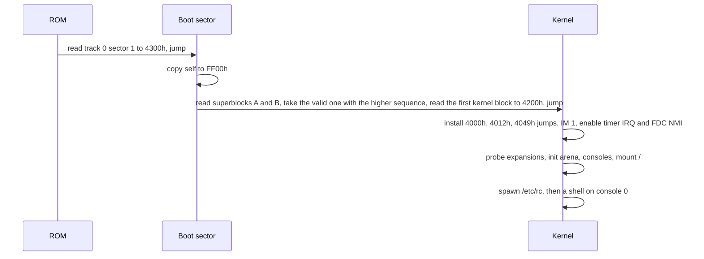

# cp500-os Design

Status: milestone 2 is implemented. Numbers marked "budget" are targets to
measure against, not facts. Addresses, escape sequences and the keyboard map
below are the ones the kernel uses.

## 1. Goals and non-goals

cp500-os is a small, Unix-flavored operating system for the Prologica CP-500
(a TRS-80 Model III compatible). "Modern" means how the system behaves, not how
big it is.

Goals:

- Runs on a stock CP-500: Z80 at 2.03 MHz, 48 KiB RAM, 64x16 text, 1-4 floppy
  drives. Optional expansions (serial, virtual hard disk, network) are detected
  at boot and used when present.
- Preemptive multitasking with a small, fixed number of tasks.
- One hierarchical file tree with long names, timestamps and exact sizes.
- Everything is a file descriptor: consoles, printer, serial port, pipes.
- Virtual consoles, a shell with line editing, history and completion.
- Relocatable programs, so several can be resident at once.
- Portuguese text works out of the box (accented letters, dead keys).

Non-goals:

- Memory protection. There is no MMU; a bad program can crash the machine.
- Running TRSDOS, LDOS or BASIC programs. They call ROM and DOS entry points
  this OS does not provide. A read-only importer copies their files instead.
- Mouse-driven GUI, Unicode, multiple users or permissions.

## 2. Hardware contract

The OS depends on exactly these ROM behaviors, verified against the CP-500 ROM
dump (CRC32 `c2fc1b92`):

| ROM address | Behavior | What the OS does with it |
|-------------|----------|--------------------------|
| reset | Reads track 0 sector 1 to `4300h` and jumps there | Boot sector entry |
| `0008h`-`0030h` | `RST n` jumps to `4000h`, `4003h`, ..., `400Fh` | `RST 08h` is the system call |
| `0038h` | IM 1 interrupt jumps to `4012h` | Interrupt service routine |
| `0066h` | NMI: `3039h` checks port `E4h` bit 5; if reset is not held, jumps to `4049h`, else waits for release and reboots | Floppy controller completion |

Everything else is hardware the kernel drives directly:

| Device | Ports / addresses | Notes |
|--------|-------------------|-------|
| Keyboard | `3800h-3BFFh` | 8x8 matrix, polled, active high |
| Video | `3C00h-3FFFh`, control `ECh` | 64x16 characters, `80h-BFh` are 2x3 block graphics (128x48), no hardware cursor, no reverse video |
| Interrupts | `E0h` IRQ mask/status, `E4h` NMI mask/status, `ECh` timer ack | 30 Hz timer IRQ, FDC INTRQ on NMI |
| Floppy | `F0h-F3h` WD1791, `F4h` drive select/side/WAIT/MFM | 40 tracks, 18 x 256-byte sectors, 180 or 360 KiB |
| Printer | `F8h` | Parallel, status + data |

There is no real-time clock, no memory banking and no DMA. Interrupt mode 1 is
used rather than mode 2: the ROM already routes it to RAM, and mode 2 would
depend on what the data bus floats to during acknowledge, which is not
guaranteed on real hardware.

## 3. Memory map

```text
0000-37FF  ROM (fixed, 14 KiB)
3800-3BFF  keyboard matrix
3C00-3FFF  video RAM (64x16)
4000-40FF  system page
4100-41FF  boot and idle stack
4200-61FF  kernel code and static data (8 KiB budget)
6200-FFFF  arena: 158 pages of 256 bytes (39.5 KiB)
```

System page (`4000h-40FFh`):

| Address | Content |
|---------|---------|
| `4000h` | `JP syscall` (target of `RST 08h`) |
| `4003h`-`400Fh` | `RST 10h`-`30h` slots, reserved. `RST 30h` is the debugger breakpoint |
| `4012h` | `JP isr` |
| `4015h`-`4048h` | Kernel variables (tick counter, current task, flags) |
| `4049h` | `JP nmi` |
| `404Ch`-`40FFh` | Kernel variables |

The boot sector lands at `4300h`, inside the kernel range. It first copies
itself to `FF00h` and continues there, then loads the first kernel block to
`4200h`. That block loads the rest of the run to `4300h` and jumps there. A
256-byte sector cannot hold the CRC, the superblock choice and a multi-block
read together. The boot sector's own divide uses the low byte of the kernel
start, so that block number has to be below 256. The continuing loader uses
the full 16-bit start.

### Arena

All dynamic memory comes from the arena in 256-byte pages. A page owner table
(158 bytes, one per page) records `00h` free, `FFh` kernel, or the owning task
id, so everything a task owned is freed when it exits.

- Programs and their stacks are allocated from the bottom up, first fit.
- Kernel buffers (disk cache, console shadow screens, pipes) are allocated from
  the top down. This keeps long-lived kernel data from fragmenting the space
  programs load into.
- There is no compaction: without an MMU, absolute pointers cannot be moved.

Budget at boot with two virtual consoles: disk cache 7 pages, one inactive
console shadow 4 pages, leaving about 36 KiB for programs.

## 4. Tasks and scheduling

- Up to 8 tasks. Task 0 is the idle task: `HALT` until the next interrupt.
- Round-robin, quantum of 2 ticks (66 ms). A task that blocks gives up the rest
  of its quantum.
- The kernel is not preemptive. A tick that arrives during a system call only
  sets a reschedule flag, honored when the call returns to user code. This
  avoids locks inside the kernel.
- A context switch pushes `AF BC DE HL IX IY AF' BC' DE' HL'` on the current
  task's stack and saves `SP` in the task table.
- Kernel code runs on the calling task's stack. Every task stack must reserve
  192 bytes for the kernel and interrupt frames on top of its own needs. The
  loader adds this automatically.

Task table entry (32 bytes):

| Field | Size | Meaning |
|-------|------|---------|
| state | 1 | free, ready, blocked, zombie |
| saved SP | 2 | |
| wait channel | 2 | What a blocked task waits for |
| wake tick | 2 | For `sleep` and timeouts |
| parent | 1 | Task id |
| console | 1 | Controlling console |
| exit code | 1 | Valid when zombie |
| cwd | 3 | Volume id + inode |
| fd table | 8 | Index into the open-file table per descriptor, `FFh` unused |
| program base | 1 | First arena page |
| reserved | 10 | |

### Processes are spawned, not forked

`fork` would need to copy a program and fix up its pointers, which is
impossible without an MMU. `spawn` loads a new program, sets up its arguments,
environment and file descriptors, and makes it ready, like `posix_spawn`. A
shell runs `a | b > f` as two spawns with a pipe and a redirection.

### Break

BREAK on the active console terminates the console's foreground task, unless
that console is in raw mode, where BREAK is delivered as a key code. The shell
sets the foreground task with an `ioctl` before waiting for a child.

## 5. Interrupts and drivers

### Timer interrupt (30 Hz)

`4012h` jumps to the interrupt service routine, which:

1. Pushes the full register set on the current stack.
2. Reads `E0h` to find the source, reads `ECh` to acknowledge the timer.
3. Advances the tick counter and wakes sleepers whose time has come.
4. Scans the keyboard matrix (debounce, repeat, ring buffer).
5. Switches tasks if the quantum ran out and the kernel is not busy.
6. Pops the registers, `EI`, `RETI`.

### Keyboard

Scanned every tick. A key must read the same in two consecutive scans to
count, which gives up to 66 ms of latency, comparable to the ROM. Repeat starts
after 15 ticks (0.5 s) and runs at one key every 3 ticks. Keys go into a
32-entry ring buffer per active console. Dead keys compose accents (`'` + `a`
gives `á`). CLEAR plus a digit switches virtual consoles.

Milestone 2 pins the scan in the system page. `4015h` is the 4-byte
little-endian tick count. The ring is 32 bytes at `4026h`, with the head at
`4019h` (the scanner writes it) and the tail at `401Ah` (the main line writes
it). One slot stays empty so the two indexes can tell full from empty. Repeat
state is `401Bh`-`401Dh`. Raw samples are `401Eh`-`4025h`. Debounced rows are
`404Ch`-`4053h`.

Row `n` is the byte at `3800h` with address bit `n` set (`3801h` is `@` and
A-G). Unshifted letters are lowercase, so a typed `Hi` is `Hi`. SHIFT is row 7
bit 0 and changes the glyph. ENTER is `0Dh` and moves to column 0 of the next
row. BREAK, CLEAR and SHIFT alone are dropped. UP is the `[` key. DOWN, LEFT
and RIGHT are delivered as `ESC [ B`, `ESC [ D` and `ESC [ C`. Dead keys and
Portuguese glyph mapping are not in this milestone. A `--type` hold is about
three ticks, so it cannot reach the repeat delay.

### Console

- Each virtual console is 64x16. The active one lives in video RAM; inactive
  ones keep a 1 KiB shadow copy in the arena. Switching swaps the two, about
  20 ms.
- Output understands a subset of ANSI/VT100 escape sequences: cursor movement
  and positioning, erase line/screen, save/restore cursor. This keeps ported
  programs and future serial or telnet sessions consistent. Milestone 2
  accepts `ESC 7` and `ESC 8` (save and restore), `ESC [ A/B/C/D` (move; a
  missing or zero count moves one cell), `ESC [ H` and `ESC [ f` (1-based
  position; a missing row or column is 1), `ESC [ J` and `ESC [ K` (0 from
  the cursor, 1 through the cursor, 2 the whole screen or line; a missing
  count is 0). An unknown sequence is discarded. The cursor is the `BFh`
  block, saved and restored around blinks. Console state is `4054h`-`4061h`.
- Text is ISO-8859-1. The console maps accented letters onto the CP-500's
  Portuguese glyphs at `00h-1Fh` and falls back to the base letter where no
  glyph exists. The exact table comes from the character generator dump.
- Raw glyph mode (`ioctl`) writes bytes straight to video RAM codes, for block
  graphics and katakana.
- The cursor is drawn in software by blinking a block on the tick.
- Default: 2 consoles. A shell is started on a console the first time it is
  shown, not at boot, to save memory.

### Floppy

`floppy_read` is the polled loop the boot sector already runs. `DE` is the
16-bit block and `HL` is the 256-byte destination. The routine divides by
`VOL_SPT`, then takes the track from the quotient (shifted right when the
volume has two sides) and the sector from the remainder plus one. A track
above 255 is `EIO`. Interrupts stay off for the seek and the read. Seek is
`FDC_CMD_SEEK` with head load and the 30 ms step rate, followed by a poll for
not-busy. The read is `FDC_CMD_READ`. Not-busy before 256 bytes is `EIO`.
`DRQ` moves one byte with `INI`, and `B` starts at 0 so the loop runs 256
times. A 16-bit poll that expires is `EIO`. After the sector, not ready, CRC
error, record not found, or lost data is `EIO`. Both returns enable
interrupts. The routine does not call the console. `DE`, `HL`, `IX`, `IY`,
and the alternate registers are unchanged. `DISK_WAIT` is never set.
`PORT_NMI` stays 0. `nmi` is `RETN`.

`floppy_write` is the same poll with `FDC_CMD_WRITE` and `OUTI`. A failed
write, including write protect or write fault, is `EIO`. This is the polled
path. WAIT plus NMI is still not claimed.

The Model III WAIT-plus-INTRQ transfer is not implemented and is not claimed.
A green emulator run shows only that the poll completed the sector. The notes
below describe that unimplemented technique.

- Sector transfers would run with interrupts off, WAIT enabled on the disk
  port, an `INI` loop that the WAIT line paces against DRQ, and the FDC's
  INTRQ arriving as NMI to end the transfer. At 2 MHz, MFM leaves about 65 CPU
  cycles per byte, so no interrupt may run during a transfer. One sector holds
  interrupts off for about 8 ms, well under a tick. The timer IRQ stays
  latched and is serviced right after.
- Seeks would run with interrupts on. The NMI handler would record completion
  and the waiting task would wake on the next tick, so other tasks run during
  seeks.
- Disk changes cannot be detected by hardware on this machine. After a drive
  has been idle for 2 s (motor off), the next access rereads the superblock
  and compares the volume id and generation (section 7). A mismatch drops the
  cached blocks, and open files on that volume fail with `ECHANGED`.
- Floppy writes are write-through: the user can eject at any moment.

### Block device interface

All storage is addressed in 256-byte blocks, the native sector size of both the
floppies and the Model III hard disk interface.

```text
read_block(dev, block, buffer)    write_block(dev, block, buffer)
block_count(dev)                  media_check(dev) -> unchanged | changed | absent
```

Character devices implement `open`, `close`, `read`, `write`, `ioctl`. Drivers
for expansions are built into the kernel at first and enabled only when their
probe finds the hardware; open-bus reads return `FFh`, so a probe writes and
reads back a register with known behavior.

## 6. System call interface

Programs call the kernel with `RST 08h`. The ROM forwards it to `4000h`, which
jumps to the dispatcher. One byte per call, and no program needs to know where
the kernel lives.

Registers:

| Register | Role |
|----------|------|
| `C` | Function number |
| `DE`, `HL`, `B` | Arguments 1, 2, 3 |
| `IX` | Pointer argument 4, when needed |
| `HL` | Result |
| `A` | Error code, `0` on success |
| carry | Set on error, so assembly can `RST 08h` then `JR C,fail` |

The kernel preserves `IX`, `IY` and the alternate register set, and destroys
`AF`, `BC`, `DE`, `HL`. Values wider than 16 bits (file offsets, times) are
passed through a pointer to 4 little-endian bytes.

### Functions

Process:

| # | Name | Arguments | Result |
|---|------|-----------|--------|
| `00h` | exit | `DE` code | does not return |
| `01h` | spawn | `DE` path, `HL` argv/envp block, `IX` fd map | `HL` task id |
| `02h` | wait | `DE` task id (`FFh` = any child) | `HL` low = exit code, high = task id |
| `03h` | getpid | | `HL` task id |
| `04h` | yield | | |
| `05h` | sleep | `DE` ticks | |
| `06h` | kill | `DE` task id | |
| `07h` | uptime | `DE` pointer to 4 bytes | tick count since boot |

Memory:

| # | Name | Arguments | Result |
|---|------|-----------|--------|
| `10h` | alloc | `DE` pages | `HL` address |
| `11h` | free | `DE` address | |
| `12h` | meminfo | `DE` pointer to info record | |

Files and directories:

| # | Name | Arguments | Result |
|---|------|-----------|--------|
| `20h` | open | `DE` path, `B` flags (read, write, create, truncate, append, exclusive) | `HL` fd |
| `21h` | close | `DE` fd | |
| `22h` | read | `DE` fd, `HL` buffer, `IX` length | `HL` bytes read, `0` at end |
| `23h` | write | `DE` fd, `HL` buffer, `IX` length | `HL` bytes written |
| `24h` | seek | `DE` fd, `HL` pointer to 4-byte offset (updated), `B` whence | |
| `25h` | stat | `DE` path, `HL` stat record | |
| `26h` | fstat | `DE` fd, `HL` stat record | |
| `27h` | readdir | `DE` fd of an open directory, `HL` entry record | `HL` `0` at end |
| `28h` | mkdir | `DE` path | |
| `29h` | remove | `DE` path (file or empty directory) | |
| `2Ah` | rename | `DE` old path, `HL` new path | |
| `2Bh` | chdir | `DE` path | |
| `2Ch` | getcwd | `DE` buffer, `HL` size | |
| `2Dh` | dup2 | `DE` old fd, `HL` new fd | |
| `2Eh` | pipe | `DE` pointer to 2 bytes | read fd, write fd |
| `2Fh` | ioctl | `DE` fd, `HL` request, `IX` argument | `HL` request-specific |
| `30h` | sync | | Flushes all write-back caches |

Time:

| # | Name | Arguments | Result |
|---|------|-----------|--------|
| `40h` | time | `DE` pointer to 4 bytes | Seconds since 1980-01-01 00:00 local time |
| `41h` | settime | `DE` pointer to 4 bytes | |

`50h-5Fh` are reserved for sockets (section 9).

Limits: 8 descriptors per task, 16 open files system-wide, 4 pipes of 256 bytes
each, paths up to 127 bytes.

### Milestone 3 calls

The kernel implements `exit`, `spawn`, `wait`, `getpid`, `open`, `close`,
`read`, `write`, `seek`, `stat`, `fstat`, `readdir`, `mkdir`, `remove`,
`rename`, `chdir`, and `getcwd`. Every other `C`, including `yield`, `sleep`,
`kill`, `uptime`, `alloc`, `free`, `meminfo`, `dup2`, `pipe`, `ioctl`,
`sync`, `time`, and `settime`, returns `EINVAL` with `HL = 0` and carry set.

Success is `A = 0`, carry clear, and the result in `HL`. Failure is `A` set
to the code, `HL = 0`, and carry set. `exit` does not return. `spawn` returns
task id 2 and leaves the child pending. `wait` of `FFh` or 2 runs that child.
The child's `exit` completes the wait with `HL = (2 << 8) | exit_code`.
`getpid` is 1 for the shell and 2 for the child. A second `spawn` while a
child is pending or running is `EBUSY`.

`open` for read of a file or a directory takes the lowest free descriptor.
`read` of a directory is `EISDIR`. `readdir` of a file is `ENOTDIR`. `fstat`
of a console descriptor is `EINVAL`. `write` of a file or directory
descriptor is `EROFS` and does not walk a path. `write` of descriptor 0 is
`EBADF`. Descriptors 1 and 2 write the console. `mkdir`, `remove`, and
`rename` walk first, then refuse the change with `EROFS` when the name
resolution would have modified the volume. `remove` of `/` is `EBUSY`.

`seek` takes a file descriptor in `DE`, a pointer to a signed 32-bit
little-endian offset in `HL`, and a whence in `B`. Whence 0 sets the
position, 1 adds to the current position, and 2 adds to the file size. Any
other whence, or a directory or console descriptor, is `EINVAL`. A negative
result, or a sum that does not fit in a signed 32-bit value, is `EINVAL` and
leaves the position unchanged. Otherwise the new position is stored and
written back through `HL`. A position past the file size is legal, and the
next `read` returns 0.

`chdir` takes an absolute path in `DE`. The walk starts at inode 1. The inode
must be a directory. The task stores volume 0 at offset 5 and the inode at
offsets 14 and 15. `getcwd` takes a buffer in `DE` and a size in `HL`. Inode
1 is `/`. Any other cwd reads directory slot 0 for the parent, finds the
child's name there, and repeats until the root. A missing name is `EIO`. A
buffer shorter than the path plus a NUL is `EINVAL` and is left untouched.

`stat` and `fstat` write this 16-byte record:

| Offset | Size | Field |
|--------|------|-------|
| 0 | 2 | Inode number |
| 2 | 1 | Inode type with the indirect bit and bit 7 cleared |
| 3 | 1 | 0 |
| 4 | 4 | Size, low 3 bytes from the inode, high byte 0 |
| 8 | 4 | Modified |
| 12 | 4 | Created |

`readdir` copies one 32-byte directory slot, including `..`. Holes are
skipped. `HL` is 1 when an entry was stored and 0 at the end. Both are
success. The slot is inode (2 bytes) then a 30-byte NUL-padded name.

The argv block is `argc`, `envc`, then that many NUL-terminated strings.
Both counts are 0 to 8. The shell passes `00 00`. The loader copies the block
to `load + image + bss` and sets `SP` to `load + image + bss + stack + 192`.

### Error codes

| Code | Name | | Code | Name |
|------|------|-|------|------|
| 1 | `ENOENT` | | 10 | `ENOEXEC` |
| 2 | `EEXIST` | | 11 | `EMFILE` |
| 3 | `ENOMEM` | | 12 | `ECHILD` |
| 4 | `EBADF` | | 13 | `EROFS` |
| 5 | `EINVAL` | | 14 | `ENOTEMPTY` |
| 6 | `ENOSPC` | | 15 | `EBUSY` |
| 7 | `EIO` | | 16 | `EAGAIN` |
| 8 | `ENOTDIR` | | 17 | `ECHANGED` (disk was swapped) |
| 9 | `EISDIR` | | 18 | `ENODEV` |

### Program format and loading

Programs are linked at `0000h` and loaded on a page boundary. Relocation only
has to add the load page to the high byte of every absolute address, which
keeps both the table and the loader small (the approach CP/M 3 uses for PRL
files).

```text
offset  size        field
0       4           magic "C5X" (43h 35h 58h), version byte 01h
4       2           image size n (code + initialized data)
6       2           bss size
8       2           stack size (the loader adds the 192-byte kernel reserve)
10      2           entry offset
12      4           reserved, must be 00h
16      n           image, linked at 0000h
16+n    ceil(n/8)   relocation bitmap: bit i set means image byte i is the
                    high byte of an absolute address
```

All fields are little-endian. The file is exactly `16 + n + ceil(n/8)`
bytes. Bit `i` of the bitmap is bit `i % 8` (least significant first) of
bitmap byte `i / 8`, and bits past `n` in the last byte are zero. Readers
reject a wrong magic or version, nonzero reserved bytes, a short or long file
and set padding bits, so a future version can give them meaning.

The build computes the bitmap toolchain-independently: link the program at
`0000h` and at `0100h` and mark every byte that is exactly 1 higher (mod 256)
in the second link. A byte that changes by anything else means the code is not
page-relocatable (for example it uses the low byte of an address, or
`addr + 80h` arithmetic that carries differently), and the build fails with
the offending offsets.

Relocating to page `p` (load address `p * 256`) adds `p` mod 256 to every
marked byte and touches nothing else. `Relocator.Relocate` in `Cp500Os.C5x`
is that exact algorithm and is the oracle the kernel loader tests compare
against.

A valid header has `entry offset < image size` (so the image is never empty)
and `image + bss + stack + 192` at most 40,448 bytes, the 158-page arena.

`mkreloc <link0000.bin> <link0100.bin> -o <out.c5x> [--bss n] [--stack n]
[--entry n]` writes the file; numbers are decimal or `0x` hex, and the
defaults are bss 0, stack 256 and entry 0. `mkreloc --info <file.c5x>` prints
the header, relocation count and the memory the loader will allocate.

At `spawn` the kernel allocates one block for image, bss and stack, relocates
it, copies argv and the environment just below the stack, and starts the task
at the entry point with `SP` set. The C runtime's startup code turns that into
`argc`, `argv` and `environ`.

## 7. File system (C5FS)

This section is the on-disk format. The host library (`src/Cp500Os.C5fs`) and
the `c5fs` tool implement it exactly; the kernel must read and write the same
bytes.

### Parameters

- Block = 256 bytes = one sector. Block numbers are 16-bit, so a volume holds
  at most 65,535 blocks (16 MiB). A virtual hard disk can be larger and is
  split into partitions.
- All multi-byte integers are little-endian.
- Floppies have 40 tracks of 18 sectors. A 360 KiB floppy has 2 sides and
  1440 blocks; a 180 KiB floppy has 1 side and 720 blocks.
- Floppy block `n` maps to track `n / (18 * sides)`, side
  `(n / 18) % sides`, sector `n % 18 + 1`. Raw images are track-major with
  the sides interleaved, so block `n` is at byte `n * 256` of the image.
  Images are exactly 184,320 or 368,640 bytes.

### Layout

| Blocks | Content |
|--------|---------|
| 0 | Boot sector (floppies) or partition table (hard disk) |
| 1, 2 | Superblock copies A and B |
| 3 .. | Allocation bitmap, `ceil(block count / 2048)` blocks (1 on floppies, 32 on 16 MiB) |
| .. | Inode table, `inode count / 8` blocks |
| .. | Data, from the first data block to the end |

The inode table starts right after the bitmap and the first data block right
after the inode table. Format presets:

| | 180 KiB | 360 KiB |
|-|---------|---------|
| Inodes (usable) | 64 (63) | 128 (127) |
| Bitmap | block 3 | block 3 |
| Inode table | blocks 4-11 | blocks 4-19 |
| First data block, root directory | 12 | 20 |
| Free after format | 707 blocks, 62 inodes | 1419 blocks, 126 inodes |

On a hard disk, block 0 holds up to 4 partition entries (type, start block,
block count, 3 bytes each for start and count), and each partition is a C5FS
volume starting with its own block 0 (unused) and superblocks at 1 and 2.
Partition volumes record sides, tracks and sectors as `0`.

### Allocation bitmap

Block `n` is bit `n % 8` (least significant first) of byte `n / 8`, counting
from the first bitmap block; `1` = used. The blocks before the first data
block are always marked used. The padding bits past the last block, up to the
end of the last bitmap block, are always `1`, so a byte-wise scan for a
non-`FFh` byte never finds a block that does not exist.

The free block count is not stored; the kernel counts the bitmap at mount,
which avoids a superblock write per allocation.

### Superblock

| Offset | Size | Field |
|--------|------|-------|
| 0 | 4 | Magic `C5FS` |
| 4 | 1 | Version, `1` |
| 5 | 1 | Flags: bit 0 clean; other bits `0` |
| 6 | 4 | Sequence number |
| 10 | 4 | Volume id, random at format time |
| 14 | 2 | Generation, `1` at format |
| 16 | 2 | Block count |
| 18 | 2 | Bitmap start block, `3` |
| 20 | 1 | Bitmap length in blocks |
| 21 | 2 | Inode table start |
| 23 | 2 | Inode count (table slots, a multiple of 8) |
| 25 | 2 | First data block |
| 27 | 1 | Sides (`0` on hard disk) |
| 28 | 1 | Tracks per side (`0` on hard disk) |
| 29 | 1 | Sectors per track (`0` on hard disk) |
| 30 | 2 | Kernel start block, `0` when there is no kernel |
| 32 | 2 | Kernel block count, `0` when there is no kernel, otherwise 1-255 |
| 34 | 4 | Created, seconds since 1980 |
| 38 | 4 | Last written, seconds since 1980 |
| 42 | 16 | Volume label, printable ISO-8859-1, NUL padded (16 bytes has no NUL) |
| 58 | 196 | Reserved, `0` |
| 254 | 2 | CRC over bytes 0-253 |

The CRC is CRC-16/CCITT-FALSE: polynomial `1021h`, initial value `FFFFh`, no
reflection, no final XOR. Its check value (CRC of ASCII `123456789`) is
`29B1h`.

Choosing a copy: a copy is valid when its magic and CRC check out. Of the
valid copies, the one with the higher sequence number wins; on a tie, A wins.
Every reader applies this rule, the boot sector included. Writes go to the
copy that is not current, with the sequence number incremented, so a write
torn by power loss always leaves the previous copy intact. A volume with no
valid copy does not mount.

Format writes both copies, identical except for the sequence: A gets 1 and B
gets 2, so B is current on a fresh volume and the first write goes to A.

The generation lets a kernel that cached a floppy notice that it was changed
elsewhere (section 5). It is incremented each time the volume goes from clean
to dirty. A host tool session (open the image, make changes, save it) counts
as one such transition: it writes one new superblock copy with sequence + 1,
generation + 1, the clean flag set and "last written" updated. A session that
changes nothing writes nothing and leaves the image byte-identical.

### Inode (32 bytes)

Inode `n` is slot `n` of the inode table (block `table start + n / 8`, offset
`(n % 8) * 32`). Slot 0 is reserved and stays all zero, because inode number
`0` in a directory entry means a free entry. Inode 1 is the root directory.
A free inode is 32 zero bytes.

| Offset | Size | Field |
|--------|------|-------|
| 0 | 1 | Type and flags, see below |
| 1 | 1 | Extent count |
| 2 | 3 | Size in bytes (24-bit, at most 16,777,215) |
| 5 | 4 | Modified, seconds since 1980 |
| 9 | 4 | Created, seconds since 1980 |
| 13 | 18 | 6 extent slots of (start block 2 bytes, length 1 byte) |
| 31 | 1 | Reserved, `0` |

Type byte: bits 0-3 type (`0` free, `1` file, `2` directory), bit 4
read-only, bit 5 hidden, bit 6 indirect extents, bit 7 `0`.

An extent is a run of 1-255 consecutive blocks inside the data area. A file
owns exactly `ceil(size / 256)` data blocks in total; nothing is
preallocated, and the bytes after the end of the file in its last block are
`0`.

- With 6 extents or fewer, they sit in the inline slots in file order, the
  extent count is the number used, the indirect flag is clear and unused
  slots are zero.
- With 7 to 90 extents, the indirect flag is set and the extent count is the
  total. Inline slots 1-5 hold extents 1-5. Slot 6 holds the indirect block
  number in its 2 start bytes and `0` in its length byte. The indirect block
  holds extents 6 onwards packed 3 bytes each from offset 0 (up to 85), and
  its remaining bytes are zero. The indirect block is marked used in the
  bitmap and belongs to the inode; it is freed when the extent count drops
  back to 6.

### Directories

A directory is a file of 32-byte entries, 8 per block:

| Offset | Size | Field |
|--------|------|-------|
| 0 | 2 | Inode number, `0` = free entry |
| 2 | 30 | Name, ISO-8859-1, NUL padded |

- The first entry of every directory is `..`, pointing at the parent. The
  root's `..` points at inode 1. `.` is not stored.
- The size is a non-zero multiple of 32. A directory grows by one entry at a
  time and by one zeroed block when the last block is full. Removing an entry
  zeroes all 32 bytes; free entries are reused before the directory grows, and
  directories never shrink.
- Names are 1-30 bytes. A 30-byte name has no terminator; after a shorter
  name every byte is `0`. Allowed bytes are the printable ISO-8859-1
  characters (`20h-7Eh` and `A0h-FFh`) except `/`. `.` and `..` are reserved.
- Names are case-preserving and compared case-insensitively by folding each
  byte: `A-Z` to `a-z`, and `C0h-DEh` to `E0h-FEh` except `D7h` (multiplication
  sign). So `Ação` equals `AÇÃO`, but `Acao` does not equal `Ação`: this is
  case folding, not accent stripping. `DFh` and `FFh` have no partner. Two
  entries of one directory never have equal folded names.
- Paths are absolute, `/`-separated and at most 127 bytes.
- An inode is referenced by exactly one directory entry (no hard links).

Host tools convert names to Unicode NFC and then to ISO-8859-1, rejecting
characters outside it. They list directories in folded byte order.

### Allocation

The kernel and the host tools allocate the same way, so images built on the
host look like images written by the OS:

1. Extend the file's last extent in place while the next blocks are free and
   the extent stays within 255 blocks.
2. Otherwise take the lowest-numbered free run that holds all remaining
   blocks (at most 255).
3. Otherwise take the lowest-numbered free run whatever its size, and repeat.

An indirect block, when needed, is the lowest-numbered free block once the
data blocks are allocated. A file that would need more than 90 extents fails
with `ENOSPC`. The allocator prefers extending the last extent, so files
written sequentially on a fresh disk use one or two extents, and reading them
needs no extra block lookups. Replacing a file's contents frees its old blocks
first and keeps its inode number, attributes and creation time.

### Boot sector and kernel

Block 0 holds up to 256 bytes of boot code, zero-padded.

The kernel is the regular file `/sys/kernel`, stored as exactly one extent of
1-255 blocks (budget: 8 KiB, 32 blocks). The superblock's kernel start and
count record that extent, so the 256-byte boot sector only has to read a block
range and needs no file system code. The `sys` tool installs it: it frees the
previous kernel, takes the lowest-numbered run of enough contiguous free
blocks and fails with `ENOSPC` when there is none. Writing `/sys/kernel` as an
ordinary file is refused, and removing it clears the superblock's kernel
fields, so the two always agree.

### Consistency rules

`fsck` and `c5fs check` verify, reporting every violation:

- The current superblock is valid and its layout fields match the block and
  inode counts.
- Every allocated inode is well-formed as described above, including its
  indirect block and size against its extents. Free inodes and slot 0 are
  all zero.
- The bitmap equals the set of owned blocks exactly: metadata blocks, inode
  extents and indirect blocks, with no block owned twice. Padding bits are set.
- Every directory starts with a correct `..`, has no duplicate folded names,
  only valid names, zeroed free entries, and entries that point at allocated
  inodes.
- Every inode except the root is referenced exactly once; the root is not
  referenced by any entry other than `..`.
- The superblock's kernel fields are zero exactly when `/sys/kernel` does not
  exist, and otherwise equal its single extent.

Errors use the numbers in section 6: `ENOENT`, `EEXIST`, `ENOTDIR`, `EISDIR`,
`ENOTEMPTY` with their usual meaning, `EINVAL` for bad names, paths, sizes and
images, `ENOSPC` for no free blocks, no free inodes, too many extents or no
contiguous kernel run, `EIO` for malformed on-disk structures, and `EBUSY`
for removing `/`.

### Crash consistency

No journal: it would double the writes on a medium where every random block
costs a seek plus up to 200 ms of rotation. Instead, writes are ordered so that a crash at any point
only leaks blocks or inodes, never shares a block between two files:

- Create or grow: write the bitmap with the new blocks marked used, then the
  data, then the inode, then the directory entry.
- Delete: clear the directory entry, then free the inode, then the bitmap.
- Rename within a volume: write the new entry, then clear the old one. A crash
  in between leaves the file under both names; the checker keeps one.

The superblock's clean flag is cleared (and the generation incremented) before
the first write after mount, and set again after `sync` once the volume has
been idle. Mounting a dirty volume rebuilds the bitmap from the inode table,
which on a floppy means reading about 20 blocks. `fsck` does the full check
(duplicate names, orphan inodes) on demand.

The host tools never leave a volume half-written: they change an in-memory
copy and replace the image file in one rename, so a failed command leaves the
image byte-identical.

### File tree

The boot volume is `/`. Other volumes appear under `/mnt` by device name
(`/mnt/fd1`, `/mnt/hd0p1`) and are mounted on first access. `/dev` is
provided by the kernel, not stored on disk.

```text
/bin        commands
/etc        startup script (rc), settings
/sys        kernel, fonts, keyboard maps
/tmp        scratch, emptied at boot
/home       user files
/dev        con0 con1 tty prn ser0 fd0-fd3 hd0 null
/mnt        other volumes
```

### Time without a clock

Times are unsigned 32-bit seconds since 1980-01-01 00:00 local time (no time
zone is stored), which lasts until 2116. The kernel keeps time from the 30 Hz
tick. At boot it takes, in order: the hard disk expansion's clock if present,
the network time if configured, or the root volume's "last written" time,
which at least keeps timestamps moving forward. There is no hardware clock
in this milestone. At mount the base is the volume's last-written time and
the origin tick is `TICK_COUNT`. The current time is that base plus
`(TICK_COUNT - origin) / 30`, integer division. `date` with no arguments
prints `yyyy-MM-dd HH:mm:ss`. `date` with two arguments, the date and the
time separated by a space, sets the clock. `more` shows 16 lines and then
waits for space (`20h`). The editor overwrites with printable ASCII. `:w`
then ENTER saves and exits. `:q` then ENTER quits without saving. Arrow keys
arrive as ESC `[` A/B/C/D. The on-machine `fsck` is not in this image. The
bitmap is not visible through the existing calls, and the kernel has no room
for a second copy of `VolumeChecker`. `c5fs check` remains the oracle.

## 8. Boot sequence



## 9. Expansions

Each expansion is a real or realistic piece of hardware, so the OS keeps
running on physical machines that have it. The emulator side is specified in
heh8080 (`lode/plans/cp500-expansions.md`), where the port and register
details are still marked for verification against datasheets.

| Expansion | Hardware model | OS support |
|-----------|----------------|------------|
| Serial | Model III RS-232 board (TR1602 UART, ports `E8h-EBh`), interrupt driven | `/dev/ser0`, terminal program, serial console |
| Modem bridge | Hayes-compatible "Wi-Fi modem" on the serial port: `ATDT host:port` opens a TCP connection | Telnet and BBS access with no TCP/IP code in the OS |
| Virtual hard disk | Radio Shack hard disk interface (WD1010 at `C0h-CFh`), as implemented by FreHD | `/dev/hd0`, partitions, battery-backed clock |
| Network | WIZnet W5100 TCP/IP offload chip, indirect bus mode on 4 I/O ports | Socket system calls `50h-5Fh`: `socket`, `connect`, `listen`, `accept`, `send`, `recv`, `close`, `resolve` |

TCP/IP is offloaded to the W5100 rather than run on the Z80: a software stack
would cost 10-15 KiB and most of the CPU. The modem bridge comes first because
it gives network access with only a serial driver.

## 10. Toolchain and testing

- Kernel and boot sector: Z80 assembly (sjasmplus).
- Programs: C with SDCC (`__sdcccall(1)`), plus assembly where size matters.
  The SDK provides the startup code, system call wrappers and a small libc.
- Host tools in this repo: `mkreloc` (bitmap from two links), `c5fs` (format,
  copy files in and out, install the kernel). They write raw 184,320 or
  368,640 byte images, which heh8080 mounts directly.
- Tests boot images in heh8080's headless CP-500 machine, type keys and check
  the screen. The copyrighted ROM cannot go in CI, so the repo includes a stub
  ROM that implements only the contract in section 2 (boot sector load,
  restart jumps, NMI dispatch). The real ROM is used for manual and
  local tests.

### Build layout

- Z80 sources are assembled by sjasmplus 1.24.0 (`eng/install-sjasmplus.ps1`)
  through `eng/Z80.targets`, imported by `Microsoft.Build.NoTargets` projects
  that are part of `cp500-os.slnx`. Binaries, listings and symbol files go to
  `build/z80/`.
- `include/cp500.inc` holds the hardware equates shared by the stub ROM, the
  boot sector and the kernel: memory map, system page entry points, and every
  port with its bit names (`E0h`, `E4h`, `ECh`, `F0h-F3h`, `F4h`, `F8h`). The
  names and bit meanings follow heh8080's CP-500 devices.
- `rom/stub.asm` builds `build/z80/stub.rom`.
- `tests/fixtures/z80/` holds Z80 programs the tests assemble:
  `hello-boot.asm` (`build/z80/hello-boot.bin`) is a boot sector that writes
  `BOOT OK` to the top-left of the screen and spins with interrupts disabled;
  an assert fails the build if it outgrows 256 bytes. `reloc-sample.asm` is
  assembled at `0000h`, `0100h` and `6200h`; a test runs `mkreloc` on the
  first two and checks that relocating to page `62h` reproduces the third
  byte for byte.

### Stub ROM

`build/z80/stub.rom` is exactly 14 KiB (`0000h-37FFh`); unused bytes are
`FFh`.

| Address | Content |
|---------|---------|
| `0000h` | `DI`, `JP boot` |
| `0008h`-`0030h` | `JP 4000h`, `JP 4003h`, ..., `JP 400Fh` |
| `0038h` | `JP 4012h` |
| `0066h` | `JP 4049h` |

Boot, with interrupts disabled throughout:

1. `IM 1`, `SP = 4200h` (the boot stack page). Write `00h` to `E0h` and
   `E4h`: the timer IRQ is enabled at power-on, and `DI` does not stop NMI.
2. Select drive 0 in MFM (`F4h = 81h`), force-interrupt the FDC (`D0h`).
3. Restore (`0Bh`: head load, 30 ms steps) and wait for not-busy. Not ready
   or no track 0 is an error.
4. Read sector 1 (`80h`, track register already 0) into `4300h` by polling
   status: DRQ moves one byte with `INI`; busy clearing early is an error.
5. Wait for not-busy; any of not ready, record not found, CRC error or lost
   data (`9Ch`) is an error. Otherwise `JP 4300h`.

Every command write is followed by about 100 us before status is read, since
the WD1791 status is not valid for up to 56 us (FM). Every wait is bounded:
about 2 s for the sector (more than the five revolutions after which the
WD1791 reports record not found) and about 4.5 s for the restore (more than 40
steps at 30 ms). Waits reselect the drive, which retriggers the Model III
motor-on one-shot.

On failure the stub fills video RAM with spaces, writes one of these to the
top line and halts with interrupts disabled:

| Message | Meaning (last byte is the WD1791 status in hex) |
|---------|------------------------------------------------|
| `STUB ROM: RESTORE ERROR xx` | Drive not ready or not at track 0 after restore. heh8080 shows `A4` for an empty drive, `A0` with no drives installed |
| `STUB ROM: RESTORE TIMEOUT xx` | FDC still busy after the restore wait |
| `STUB ROM: READ ERROR xx` | Read failed: `10` record not found, `08` CRC, `04` lost data, `80` not ready |
| `STUB ROM: READ TIMEOUT xx` | No data or completion within the sector wait |

Differences from the real ROM. The boot sector must not depend on any of
these:

- The NMI vector jumps straight to `4049h`. The real ROM's `3039h` first
  checks `E4h` bit 5 and reboots while the reset button is held.
- No screen clear, logo, BREAK check, index-pulse wait (the real ROM waits
  for five index pulses to see that a disk spins) or `Diskette?` retry loop.
  Without a disk the stub stops with an error instead.
- The sector is read by polling, not with WAIT and the FDC NMI. That is
  exact in heh8080, whose controller has no byte deadline by default, but
  the 59 T-state polled byte loop is not guaranteed to keep up with MFM
  (about 65 T-states per byte) on real hardware. The stub is for the
  emulator only.
- At `4300h` the state differs: the real ROM leaves `SP` near `407Dh`,
  `E0h = 04h` (timer IRQ enabled but `DI`), `RETN` at `4049h`, its own data in
  `4000h-404Bh` and `41E5h-4224h`, and the video control latch at `ECh`
  written. The stub leaves `SP = 4200h`, both interrupt masks at `00h`, and
  does not write `ECh`. Its last `CALL` leaves the return address `C2 00` at
  `41FEh`. The boot sector must set its own stack and must not use `RST`, the
  system page or the interrupt masks before it has set them up.

## 11. Milestones

1. Tooling: assembler setup, `mkreloc`, `c5fs`, stub ROM, headless runner in
   heh8080.
2. Boot: boot sector, kernel banner, timer, keyboard, console with ANSI subset.
3. Read-only C5FS, program loader, single-tasking shell. The shell is the
   C5X file `/bin/sh`, loaded at page `62h`. Its first write places `sh>` on
   video row 3 and leaves the cursor on video row 4, column 0. Typed bytes
   are echoed on that input row. The kernel does not contain a shell. A disk
   with no `/bin/sh` halts after the banner and does not echo.
4. Writable C5FS, `fsck`, core commands (`ls cp mv rm mkdir cat more date`),
   a full-screen editor.
5. Multitasking, virtual consoles, pipes, BREAK handling.
6. Serial driver and modem bridge (heh8080 expansion), terminal program.
7. Virtual hard disk, partitions, clock.
8. W5100 network driver, sockets, `telnet`, `get` (HTTP), time sync.

## 12. Open questions

- 32-column mode: support it as a console option, or ignore it?
- Should `/tmp` become a RAM disk once a hard disk frees floppy space, or stay
  on disk?
- License for the repository.
