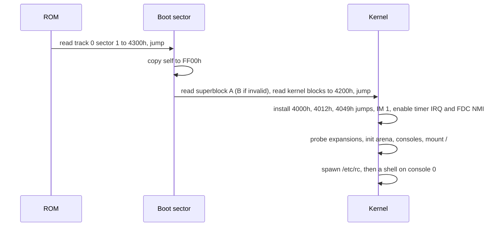

# cp500-os Design

Status: draft 1. Nothing here is implemented yet. Numbers marked "budget" are
targets to measure against, not facts.

## 1. Goals and non-goals

cp500-os is a small, Unix-flavored operating system for the Prologica CP-500
(a TRS-80 Model III compatible). "Modern" means how the system behaves, not how
big it is.

Goals:

- Runs on a stock CP-500: Z80 at 2.03 MHz, 48 KiB RAM, 64x16 text, 1-4 floppy
  drives. Optional expansions (serial, virtual hard disk, network) are detected
  at boot and used when present.
- Preemptive multitasking with a small, fixed number of tasks.
- One hierarchical file tree with long names, timestamps and exact sizes.
- Everything is a file descriptor: consoles, printer, serial port, pipes.
- Virtual consoles, a shell with line editing, history and completion.
- Relocatable programs, so several can be resident at once.
- Portuguese text works out of the box (accented letters, dead keys).

Non-goals:

- Memory protection. There is no MMU; a bad program can crash the machine.
- Running TRSDOS, LDOS or BASIC programs. They call ROM and DOS entry points
  this OS does not provide. A read-only importer copies their files instead.
- Mouse-driven GUI, Unicode, multiple users or permissions.

## 2. Hardware contract

The OS depends on exactly these ROM behaviors, verified against the CP-500 ROM
dump (CRC32 `c2fc1b92`):

| ROM address | Behavior | What the OS does with it |
|-------------|----------|--------------------------|
| reset | Reads track 0 sector 1 to `4300h` and jumps there | Boot sector entry |
| `0008h`-`0030h` | `RST n` jumps to `4000h`, `4003h`, ..., `400Fh` | `RST 08h` is the system call |
| `0038h` | IM 1 interrupt jumps to `4012h` | Interrupt service routine |
| `0066h` | NMI: `3039h` checks port `E4h` bit 5; if reset is not held, jumps to `4049h`, else waits for release and reboots | Floppy controller completion |

Everything else is hardware the kernel drives directly:

| Device | Ports / addresses | Notes |
|--------|-------------------|-------|
| Keyboard | `3800h-3BFFh` | 8x8 matrix, polled, active high |
| Video | `3C00h-3FFFh`, control `ECh` | 64x16 characters, `80h-BFh` are 2x3 block graphics (128x48), no hardware cursor, no reverse video |
| Interrupts | `E0h` IRQ mask/status, `E4h` NMI mask/status, `ECh` timer ack | 30 Hz timer IRQ, FDC INTRQ on NMI |
| Floppy | `F0h-F3h` WD1791, `F4h` drive select/side/WAIT/MFM | 40 tracks, 18 x 256-byte sectors, 180 or 360 KiB |
| Printer | `F8h` | Parallel, status + data |

There is no real-time clock, no memory banking and no DMA. Interrupt mode 1 is
used rather than mode 2: the ROM already routes it to RAM, and mode 2 would
depend on what the data bus floats to during acknowledge, which is not
guaranteed on real hardware.

## 3. Memory map

```text
0000-37FF  ROM (fixed, 14 KiB)
3800-3BFF  keyboard matrix
3C00-3FFF  video RAM (64x16)
4000-40FF  system page
4100-41FF  boot and idle stack
4200-61FF  kernel code and static data (8 KiB budget)
6200-FFFF  arena: 158 pages of 256 bytes (39.5 KiB)
```

System page (`4000h-40FFh`):

| Address | Content |
|---------|---------|
| `4000h` | `JP syscall` (target of `RST 08h`) |
| `4003h`-`400Fh` | `RST 10h`-`30h` slots, reserved. `RST 30h` is the debugger breakpoint |
| `4012h` | `JP isr` |
| `4015h`-`4048h` | Kernel variables (tick counter, current task, flags) |
| `4049h` | `JP nmi` |
| `404Ch`-`40FFh` | Kernel variables |

The boot sector lands at `4300h`, inside the kernel range. It first copies
itself to `FF00h` and continues there, then loads the kernel to `4200h`.

### Arena

All dynamic memory comes from the arena in 256-byte pages. A page owner table
(158 bytes, one per page) records `00h` free, `FFh` kernel, or the owning task
id, so everything a task owned is freed when it exits.

- Programs and their stacks are allocated from the bottom up, first fit.
- Kernel buffers (disk cache, console shadow screens, pipes) are allocated from
  the top down. This keeps long-lived kernel data from fragmenting the space
  programs load into.
- There is no compaction: without an MMU, absolute pointers cannot be moved.

Budget at boot with two virtual consoles: disk cache 7 pages, one inactive
console shadow 4 pages, leaving about 36 KiB for programs.

## 4. Tasks and scheduling

- Up to 8 tasks. Task 0 is the idle task: `HALT` until the next interrupt.
- Round-robin, quantum of 2 ticks (66 ms). A task that blocks gives up the rest
  of its quantum.
- The kernel is not preemptive. A tick that arrives during a system call only
  sets a reschedule flag, honored when the call returns to user code. This
  avoids locks inside the kernel.
- A context switch pushes `AF BC DE HL IX IY AF' BC' DE' HL'` on the current
  task's stack and saves `SP` in the task table.
- Kernel code runs on the calling task's stack. Every task stack must reserve
  192 bytes for the kernel and interrupt frames on top of its own needs. The
  loader adds this automatically.

Task table entry (32 bytes):

| Field | Size | Meaning |
|-------|------|---------|
| state | 1 | free, ready, blocked, zombie |
| saved SP | 2 | |
| wait channel | 2 | What a blocked task waits for |
| wake tick | 2 | For `sleep` and timeouts |
| parent | 1 | Task id |
| console | 1 | Controlling console |
| exit code | 1 | Valid when zombie |
| cwd | 3 | Volume id + inode |
| fd table | 8 | Index into the open-file table per descriptor, `FFh` unused |
| program base | 1 | First arena page |
| reserved | 10 | |

### Processes are spawned, not forked

`fork` would need to copy a program and fix up its pointers, which is
impossible without an MMU. `spawn` loads a new program, sets up its arguments,
environment and file descriptors, and makes it ready, like `posix_spawn`. A
shell runs `a | b > f` as two spawns with a pipe and a redirection.

### Break

BREAK on the active console terminates the console's foreground task, unless
that console is in raw mode, where BREAK is delivered as a key code. The shell
sets the foreground task with an `ioctl` before waiting for a child.

## 5. Interrupts and drivers

### Timer interrupt (30 Hz)

`4012h` jumps to the interrupt service routine, which:

1. Pushes the full register set on the current stack.
2. Reads `E0h` to find the source, reads `ECh` to acknowledge the timer.
3. Advances the tick counter and wakes sleepers whose time has come.
4. Scans the keyboard matrix (debounce, repeat, ring buffer).
5. Switches tasks if the quantum ran out and the kernel is not busy.
6. Pops the registers, `EI`, `RETI`.

### Keyboard

Scanned every tick. A key must read the same in two consecutive scans to
count, which gives up to 66 ms of latency, comparable to the ROM. Repeat starts
after 15 ticks (0.5 s) and runs at one key every 3 ticks. Keys go into a
32-entry ring buffer per active console. Dead keys compose accents (`'` + `a`
gives `á`). CLEAR plus a digit switches virtual consoles.

### Console

- Each virtual console is 64x16. The active one lives in video RAM; inactive
  ones keep a 1 KiB shadow copy in the arena. Switching swaps the two, about
  20 ms.
- Output understands a subset of ANSI/VT100 escape sequences: cursor movement
  and positioning, erase line/screen, save/restore cursor. This keeps ported
  programs and future serial or telnet sessions consistent.
- Text is ISO-8859-1. The console maps accented letters onto the CP-500's
  Portuguese glyphs at `00h-1Fh` and falls back to the base letter where no
  glyph exists. The exact table comes from the character generator dump.
- Raw glyph mode (`ioctl`) writes bytes straight to video RAM codes, for block
  graphics and katakana.
- The cursor is drawn in software by blinking a block on the tick.
- Default: 2 consoles. A shell is started on a console the first time it is
  shown, not at boot, to save memory.

### Floppy

- Sector transfers use the Model III technique: interrupts off, WAIT enabled in
  `F4h`, an `INI` loop that the WAIT line paces against DRQ, and the FDC's
  INTRQ arriving as NMI to end the transfer. At 2 MHz, MFM leaves about 65 CPU
  cycles per byte, so no interrupt may run during a transfer. One sector holds
  interrupts off for about 8 ms, well under a tick; the timer IRQ stays
  latched and is serviced right after.
- Seeks run with interrupts on. The NMI handler records completion and the
  waiting task is woken on the next tick, so other tasks run during seeks.
- Disk changes cannot be detected by hardware on this machine. After a drive
  has been idle for 2 s (motor off), the next access rereads the superblock
  and compares the volume id and generation (section 7). A mismatch drops the
  cached blocks, and open files on that volume fail with `ECHANGED`.
- Floppy writes are write-through: the user can eject at any moment.

### Block device interface

All storage is addressed in 256-byte blocks, the native sector size of both the
floppies and the Model III hard disk interface.

```text
read_block(dev, block, buffer)    write_block(dev, block, buffer)
block_count(dev)                  media_check(dev) -> unchanged | changed | absent
```

Character devices implement `open`, `close`, `read`, `write`, `ioctl`. Drivers
for expansions are built into the kernel at first and enabled only when their
probe finds the hardware; open-bus reads return `FFh`, so a probe writes and
reads back a register with known behavior.

## 6. System call interface

Programs call the kernel with `RST 08h`. The ROM forwards it to `4000h`, which
jumps to the dispatcher. One byte per call, and no program needs to know where
the kernel lives.

Registers:

| Register | Role |
|----------|------|
| `C` | Function number |
| `DE`, `HL`, `B` | Arguments 1, 2, 3 |
| `IX` | Pointer argument 4, when needed |
| `HL` | Result |
| `A` | Error code, `0` on success |
| carry | Set on error, so assembly can `RST 08h` then `JR C,fail` |

The kernel preserves `IX`, `IY` and the alternate register set, and destroys
`AF`, `BC`, `DE`, `HL`. Values wider than 16 bits (file offsets, times) are
passed through a pointer to 4 little-endian bytes.

### Functions

Process:

| # | Name | Arguments | Result |
|---|------|-----------|--------|
| `00h` | exit | `DE` code | does not return |
| `01h` | spawn | `DE` path, `HL` argv/envp block, `IX` fd map | `HL` task id |
| `02h` | wait | `DE` task id (`FFh` = any child) | `HL` low = exit code, high = task id |
| `03h` | getpid | | `HL` task id |
| `04h` | yield | | |
| `05h` | sleep | `DE` ticks | |
| `06h` | kill | `DE` task id | |
| `07h` | uptime | `DE` pointer to 4 bytes | tick count since boot |

Memory:

| # | Name | Arguments | Result |
|---|------|-----------|--------|
| `10h` | alloc | `DE` pages | `HL` address |
| `11h` | free | `DE` address | |
| `12h` | meminfo | `DE` pointer to info record | |

Files and directories:

| # | Name | Arguments | Result |
|---|------|-----------|--------|
| `20h` | open | `DE` path, `B` flags (read, write, create, truncate, append, exclusive) | `HL` fd |
| `21h` | close | `DE` fd | |
| `22h` | read | `DE` fd, `HL` buffer, `IX` length | `HL` bytes read, `0` at end |
| `23h` | write | `DE` fd, `HL` buffer, `IX` length | `HL` bytes written |
| `24h` | seek | `DE` fd, `HL` pointer to 4-byte offset (updated), `B` whence | |
| `25h` | stat | `DE` path, `HL` stat record | |
| `26h` | fstat | `DE` fd, `HL` stat record | |
| `27h` | readdir | `DE` fd of an open directory, `HL` entry record | `HL` `0` at end |
| `28h` | mkdir | `DE` path | |
| `29h` | remove | `DE` path (file or empty directory) | |
| `2Ah` | rename | `DE` old path, `HL` new path | |
| `2Bh` | chdir | `DE` path | |
| `2Ch` | getcwd | `DE` buffer, `HL` size | |
| `2Dh` | dup2 | `DE` old fd, `HL` new fd | |
| `2Eh` | pipe | `DE` pointer to 2 bytes | read fd, write fd |
| `2Fh` | ioctl | `DE` fd, `HL` request, `IX` argument | `HL` request-specific |
| `30h` | sync | | Flushes all write-back caches |

Time:

| # | Name | Arguments | Result |
|---|------|-----------|--------|
| `40h` | time | `DE` pointer to 4 bytes | Seconds since 1980-01-01 00:00 local time |
| `41h` | settime | `DE` pointer to 4 bytes | |

`50h-5Fh` are reserved for sockets (section 9).

Limits: 8 descriptors per task, 16 open files system-wide, 4 pipes of 256 bytes
each, paths up to 127 bytes.

### Error codes

| Code | Name | | Code | Name |
|------|------|-|------|------|
| 1 | `ENOENT` | | 10 | `ENOEXEC` |
| 2 | `EEXIST` | | 11 | `EMFILE` |
| 3 | `ENOMEM` | | 12 | `ECHILD` |
| 4 | `EBADF` | | 13 | `EROFS` |
| 5 | `EINVAL` | | 14 | `ENOTEMPTY` |
| 6 | `ENOSPC` | | 15 | `EBUSY` |
| 7 | `EIO` | | 16 | `EAGAIN` |
| 8 | `ENOTDIR` | | 17 | `ECHANGED` (disk was swapped) |
| 9 | `EISDIR` | | 18 | `ENODEV` |

### Program format and loading

Programs are linked at `0000h` and loaded on a page boundary. Relocation only
has to add the load page to the high byte of every absolute address, which
keeps both the table and the loader small (the approach CP/M 3 uses for PRL
files).

```text
offset  size        field
0       4           magic "C5X" (43h 35h 58h), version byte 01h
4       2           image size n (code + initialized data)
6       2           bss size
8       2           stack size (the loader adds the 192-byte kernel reserve)
10      2           entry offset
12      4           reserved, must be 00h
16      n           image, linked at 0000h
16+n    ceil(n/8)   relocation bitmap: bit i set means image byte i is the
                    high byte of an absolute address
```

All fields are little-endian. The file is exactly `16 + n + ceil(n/8)`
bytes. Bit `i` of the bitmap is bit `i % 8` (least significant first) of
bitmap byte `i / 8`, and bits past `n` in the last byte are zero. Readers
reject a wrong magic or version, nonzero reserved bytes, a short or long file
and set padding bits, so a future version can give them meaning.

The build computes the bitmap toolchain-independently: link the program at
`0000h` and at `0100h` and mark every byte that is exactly 1 higher (mod 256)
in the second link. A byte that changes by anything else means the code is not
page-relocatable (for example it uses the low byte of an address, or
`addr + 80h` arithmetic that carries differently), and the build fails with
the offending offsets.

Relocating to page `p` (load address `p * 256`) adds `p` mod 256 to every
marked byte and touches nothing else. `Relocator.Relocate` in `Cp500Os.C5x`
is that exact algorithm and is the oracle the kernel loader tests compare
against.

A valid header has `entry offset < image size` (so the image is never empty)
and `image + bss + stack + 192` at most 40,448 bytes, the 158-page arena.

`mkreloc <link0000.bin> <link0100.bin> -o <out.c5x> [--bss n] [--stack n]
[--entry n]` writes the file; numbers are decimal or `0x` hex, and the
defaults are bss 0, stack 256 and entry 0. `mkreloc --info <file.c5x>` prints
the header, relocation count and the memory the loader will allocate.

At `spawn` the kernel allocates one block for image, bss and stack, relocates
it, copies argv and the environment just below the stack, and starts the task
at the entry point with `SP` set. The C runtime's startup code turns that into
`argc`, `argv` and `environ`.

## 7. File system (C5FS)

### Parameters

- Block = 256 bytes = one sector. Block numbers are 16-bit, so a volume holds
  at most 16 MiB. A virtual hard disk can be larger and is split into
  partitions.
- A 360 KiB floppy has 1440 blocks; a 180 KiB floppy has 720.
- Floppy block `n` maps to track `n / (18 * sides)`, side
  `(n / 18) % sides`, sector `n % 18 + 1`.

### Layout

| Blocks | Content |
|--------|---------|
| 0 | Boot sector (floppies) or partition table (hard disk) |
| 1, 2 | Superblock copies A and B |
| 3 .. | Allocation bitmap, 1 bit per block (1 block on floppies, up to 32 on 16 MiB) |
| .. | Inode table, 8 inodes per block |
| .. | Data |

On a hard disk, block 0 holds up to 4 partition entries (type, start block,
block count, 3 bytes each for start and count), and each partition is a C5FS
volume starting with its own block 0 (unused) and superblocks at 1 and 2.

### Superblock

| Offset | Size | Field |
|--------|------|-------|
| 0 | 4 | Magic `C5FS` |
| 4 | 1 | Version |
| 5 | 1 | Flags: bit 0 clean |
| 6 | 4 | Sequence number, the copy with the higher valid sequence wins |
| 10 | 4 | Volume id, random at format time |
| 14 | 2 | Generation, incremented each time the volume goes from clean to dirty |
| 16 | 2 | Block count |
| 18 | 2 | Bitmap start block |
| 20 | 1 | Bitmap length in blocks |
| 21 | 2 | Inode table start |
| 23 | 2 | Inode count |
| 25 | 2 | First data block |
| 27 | 1 | Sides (floppy geometry, `0` on hard disk) |
| 28 | 1 | Tracks per side |
| 29 | 1 | Sectors per track |
| 30 | 2 | Kernel start block |
| 32 | 2 | Kernel block count |
| 34 | 4 | Created, seconds since 1980 |
| 38 | 4 | Last written, seconds since 1980 |
| 42 | 16 | Volume label, ISO-8859-1, NUL padded |
| 58 | 196 | Reserved |
| 254 | 2 | CRC-16/CCITT over bytes 0-253 |

The superblock is written alternately to A and B, so a write torn by power loss
always leaves one valid copy. The free block count is not stored; the kernel
counts the bitmap at mount, which avoids a superblock write per allocation.

The kernel is stored as one contiguous run of blocks, recorded in the
superblock, so the 256-byte boot sector only has to read a block range. The
`sys` tool places it.

### Inode (32 bytes)

| Offset | Size | Field |
|--------|------|-------|
| 0 | 1 | Type: free, file, directory. Flags: read-only, hidden, indirect extents |
| 1 | 1 | Extent count |
| 2 | 3 | Size in bytes (24-bit, up to 16 MiB) |
| 5 | 4 | Modified, seconds since 1980 |
| 9 | 4 | Created, seconds since 1980 |
| 13 | 18 | 6 extents of (start block 2 bytes, length 1 byte, 1-255 blocks) |
| 31 | 1 | Reserved |

When a file needs more than 6 extents, the 6th points at an indirect block
holding up to 85 more. The allocator prefers extending the last extent, so
files written sequentially on a fresh disk use one or two extents, and
reading them needs no extra block lookups.

Inode 1 is the root directory. Format defaults: 128 inodes on 360 KiB
(16 blocks), 64 on 180 KiB.

### Directories

A directory is a file of 32-byte entries, 8 per block:

| Offset | Size | Field |
|--------|------|-------|
| 0 | 2 | Inode number, `0` = free entry |
| 2 | 30 | Name, ISO-8859-1, NUL padded |

The first entry of every directory is `..`. Names are case-preserving and
compared case-insensitively, folding accented letters too (`Ação` equals
`AÇÃO`). Names may contain any printable character except `/`.

### Crash consistency

No journal: it would double the writes on a medium where every random block
costs a seek plus up to 200 ms of rotation. Instead, writes are ordered so that a crash at any point
only leaks blocks or inodes, never shares a block between two files:

- Create or grow: write the bitmap with the new blocks marked used, then the
  data, then the inode, then the directory entry.
- Delete: clear the directory entry, then free the inode, then the bitmap.
- Rename within a volume: write the new entry, then clear the old one. A crash
  in between leaves the file under both names; the checker keeps one.

The superblock's clean flag is cleared (and the generation incremented) before
the first write after mount, and set again after `sync` once the volume has
been idle. Mounting a dirty volume rebuilds the bitmap from the inode table,
which on a floppy means reading about 20 blocks. `fsck` does the full check
(duplicate names, orphan inodes) on demand.

### File tree

The boot volume is `/`. Other volumes appear under `/mnt` by device name
(`/mnt/fd1`, `/mnt/hd0p1`) and are mounted on first access. `/dev` is
provided by the kernel, not stored on disk.

```text
/bin        commands
/etc        startup script (rc), settings
/sys        kernel, fonts, keyboard maps
/tmp        scratch, emptied at boot
/home       user files
/dev        con0 con1 tty prn ser0 fd0-fd3 hd0 null
/mnt        other volumes
```

### Time without a clock

The kernel keeps time from the 30 Hz tick. At boot it takes, in order: the
hard disk expansion's clock if present, the network time if configured, or the
root volume's "last written" time, which at least keeps timestamps moving
forward. `date` sets it by hand.

## 8. Boot sequence



## 9. Expansions

Each expansion is a real or realistic piece of hardware, so the OS keeps
running on physical machines that have it. The emulator side is specified in
heh8080 (`lode/plans/cp500-expansions.md`), where the port and register
details are still marked for verification against datasheets.

| Expansion | Hardware model | OS support |
|-----------|----------------|------------|
| Serial | Model III RS-232 board (TR1602 UART, ports `E8h-EBh`), interrupt driven | `/dev/ser0`, terminal program, serial console |
| Modem bridge | Hayes-compatible "Wi-Fi modem" on the serial port: `ATDT host:port` opens a TCP connection | Telnet and BBS access with no TCP/IP code in the OS |
| Virtual hard disk | Radio Shack hard disk interface (WD1010 at `C0h-CFh`), as implemented by FreHD | `/dev/hd0`, partitions, battery-backed clock |
| Network | WIZnet W5100 TCP/IP offload chip, indirect bus mode on 4 I/O ports | Socket system calls `50h-5Fh`: `socket`, `connect`, `listen`, `accept`, `send`, `recv`, `close`, `resolve` |

TCP/IP is offloaded to the W5100 rather than run on the Z80: a software stack
would cost 10-15 KiB and most of the CPU. The modem bridge comes first because
it gives network access with only a serial driver.

## 10. Toolchain and testing

- Kernel and boot sector: Z80 assembly (sjasmplus).
- Programs: C with SDCC (`__sdcccall(1)`), plus assembly where size matters.
  The SDK provides the startup code, system call wrappers and a small libc.
- Host tools in this repo: `mkreloc` (bitmap from two links), `c5fs` (format,
  copy files in and out, install the kernel). They write raw 184,320 or
  368,640 byte images, which heh8080 mounts directly.
- Tests boot images in heh8080's headless CP-500 machine, type keys and check
  the screen. The copyrighted ROM cannot go in CI, so the repo includes a stub
  ROM that implements only the contract in section 2 (boot sector load,
  restart jumps, NMI dispatch). The real ROM is used for manual and
  local tests.

## 11. Milestones

1. Tooling: assembler setup, `mkreloc`, `c5fs`, stub ROM, headless runner in
   heh8080.
2. Boot: boot sector, kernel banner, timer, keyboard, console with ANSI subset.
3. Read-only C5FS, program loader, single-tasking shell.
4. Writable C5FS, `fsck`, core commands (`ls cp mv rm mkdir cat more date`),
   a full-screen editor.
5. Multitasking, virtual consoles, pipes, BREAK handling.
6. Serial driver and modem bridge (heh8080 expansion), terminal program.
7. Virtual hard disk, partitions, clock.
8. W5100 network driver, sockets, `telnet`, `get` (HTTP), time sync.

## 12. Open questions

- 32-column mode: support it as a console option, or ignore it?
- Should `/tmp` become a RAM disk once a hard disk frees floppy space, or stay
  on disk?
- License for the repository.
