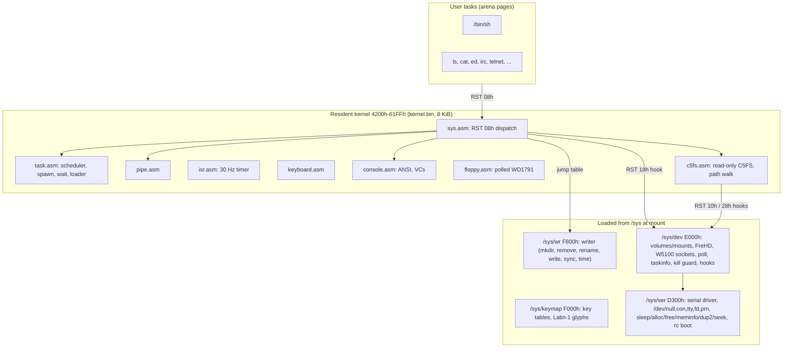
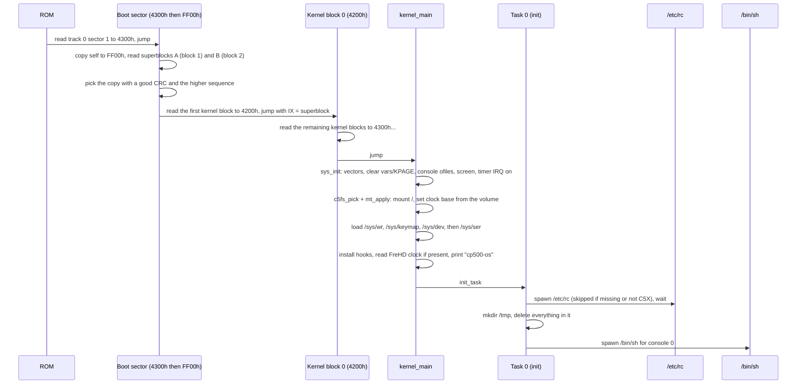

# cp500-os: How It Works

This guide explains how cp500-os is put together and what it can do, from
power-on to the shell prompt. It is written from the source tree as of
milestone 8. [design.md](design.md) is the specification: it has the
byte-level formats and the exact rules for each call. This guide explains how
the pieces fit together and how to use them. Where the two disagree, the
source wins, and [section 15](#15-where-designmd-lags-the-code) lists the
differences found.

Contents:

1. [What it is](#1-what-it-is)
2. [Feature summary](#2-feature-summary)
3. [Architecture at a glance](#3-architecture-at-a-glance)
4. [Memory map as built](#4-memory-map-as-built)
5. [Boot sequence](#5-boot-sequence)
6. [Tasks, scheduling and blocking](#6-tasks-scheduling-and-blocking)
7. [System calls](#7-system-calls)
8. [The C5FS file system](#8-the-c5fs-file-system)
9. [Devices, volumes and the file tree](#9-devices-volumes-and-the-file-tree)
10. [Console and keyboard](#10-console-and-keyboard)
11. [Using the shell](#11-using-the-shell)
12. [Command reference](#12-command-reference)
13. [Expansions: serial, hard disk, network](#13-expansions-serial-hard-disk-network)
14. [Host tools, build and tests](#14-host-tools-build-and-tests)
15. [Where design.md lags the code](#15-where-designmd-lags-the-code)
16. [Source map](#16-source-map)

---

## 1. What it is

cp500-os is a small, Unix-like operating system for the **Prologica CP-500**,
a Brazilian clone of the TRS-80 Model III. It runs on a stock machine: a Z80 at
2.03 MHz, 48 KiB of RAM, a 64x16 text screen and up to four floppy drives.
It does not use the TRSDOS ROM entry points. It takes over the machine after
the ROM loads one boot sector, and from then on it drives the hardware
directly.

"Modern" here means how the system behaves, not how big it is:

- several programs run at once, with preemption
- one tree of directories, with long names, timestamps and exact file sizes
- consoles, printer, serial port, pipes and sockets are all file descriptors
- two virtual consoles
- a shell with line editing, history, tab completion, pipes, redirection and
  background jobs
- relocatable executables, so programs can load anywhere in memory
- Portuguese accented text, typed with a dead-key acute accent

The OS is written in Z80 assembly (sjasmplus). The host tools and tests are
written in C# on .NET 10, and development uses the
[heh8080](https://github.com/fredimachado/heh8080) emulator's CP-500 machine.

What it does **not** do: there is no memory protection (the Z80 has no MMU),
it cannot run TRSDOS/LDOS/BASIC programs, and there are no users,
permissions, GUI or Unicode.

---

## 2. Feature summary

| Area | Features |
|------|----------|
| Scheduling | 8 task slots, round-robin preemption on a 30 Hz timer, 2-tick (66 ms) quantum, `spawn`/`wait`/`kill`/`yield`/`sleep`, `taskinfo` for `ps`, zombies reaped by the parent |
| Memory | 256-byte page arena with owner tracking. All pages a task owned are freed when it exits. `alloc`/`free`/`meminfo` for programs |
| Files | C5FS: extent-based, 30-byte case-insensitive Latin-1 names, 24-bit sizes, created/modified times, read-only and hidden flags, two superblock copies with CRC, ordered writes for crash safety |
| I/O | 8 fds per task, 16 open files system-wide, `dup2`, `pipe` (4 pipes of 255 bytes), `poll` on up to 8 fds, non-blocking mode, `ioctl` |
| Consoles | 2 virtual consoles (CLEAR+digit to switch), ANSI/VT100 subset, software blinking cursor, raw mode, ISO-8859-1 output |
| Keyboard | Debounced 8x8 matrix scan, auto-repeat, arrow keys as ANSI sequences, acute dead key for á é í ó ú ç and their capitals |
| Shell | Line editing, 4-line history per console, TAB completion, `a ! b` pipes, `> file` redirection, `? cmd` background jobs (`ok <id>`), `ps` and `kill <id>`, BREAK kills the foreground job |
| Storage | 180/360 KiB floppies in drives 0-3 (`/mnt/fd1`-`fd3`), raw sector devices `/dev/fd0`-`fd3`, FreHD virtual hard disk with up to 4 partitions (`/mnt/hd0p1`-`p4`) |
| Clock | Software clock from the tick. Its base comes from the FreHD battery-backed clock when present, otherwise from the volume's last-written time. `date` and `timesync` set it |
| Serial | Interrupt-driven RS-232 (`/dev/ser0`), 255-byte rings, RTS/CTS, DCD hangup, error counters, Hayes "Wi-Fi modem" use through `term` and `irc` |
| Network | WIZnet W5100 TCP offload: `socket`/`connect`/`listen`/`accept`/`send`/`recv`/`close`/`resolve`, with `telnet`, `get` (HTTP/1.0) and `timesync` (RFC 868) |
| Apps | `ls cat cp mv rm mkdir more date ed term telnet get timesync irc kill ps` |
| Host | `c5fs` (format, put/get, ls, mkdir, rm, sys, info, check, import TRSDOS/LDOS JV3/DMK disks), `mkreloc` (builds C5X executables) |

---

## 3. Architecture at a glance

A boot sector, an 8 KiB resident kernel, and four system files loaded from
`/sys` at mount make up the OS. The kernel image is full (exactly 8,192
bytes), so newer features live in the loadable files. They attach through
fixed jump tables and a set of `RST` hooks.



### The four system files

| File | Load address | Size | What it adds |
|------|--------------|------|--------------|
| `/sys/wr` | `F800h` (8 pages) | ~2 KiB | Everything that changes a volume: `mkdir`, `remove`, `rename`, open-for-write/create/truncate/append, `write`, `sync`, plus `time`/`settime`. Without it the OS still boots, read-only, and those calls return `EIO` |
| `/sys/keymap` | `F000h` (1 page) | 220 B | Unshifted and shifted key tables, acute-accent composition pairs, and the Latin-1 to video-glyph table |
| `/sys/dev` | `E000h` (16 pages) | ~3.6 KiB | The mount table and volume switching, `/mnt/...` routing, the FreHD hard-disk driver and clock, the W5100 socket calls `50h-57h`, `taskinfo` `58h`, `poll`, the task-name table and kill guard, and the hook handlers. Then loads `/sys/ser` |
| `/sys/ser` | `D300h` (13 pages) | ~3.3 KiB | The RS-232 driver, the extra `/dev` names, the six syscall bodies `sleep`, `uptime`, `alloc`, `free`, `meminfo`, `dup2`, `seek`, history ioctls, and the boot-time `/etc/rc` and `/tmp` logic |

### How the loadable modules hook in

- **Fixed jump tables.** Each module starts with a table of `JP` instructions
  at a fixed address (`WR_BASE`, `DEV_BASE`, `SER_BASE`, `EXT_OPEN`, ...). The
  addresses are equates in `include/cp500.inc`, so editing a module body never
  moves an entry point. `dev.asm` and `ser.asm` assert their table offsets.
- **Symbol import.** The modules are assembled after the kernel and include
  `kernel.sym`, so they can call kernel routines by name.
- **`RST` hooks.** The ROM vectors `RST 10h`-`28h` to `4003h`-`400Ch`. At boot
  those slots hold `RET`. `/sys/dev` overwrites them with jumps:

  | RST | Hook | Handler | Used for |
  |-----|------|---------|----------|
  | `10h` | `HOOK_DISK` | `blk_hook` | Route block I/O to the floppy or hard disk of the bound volume |
  | `18h` | `HOOK_CALL` | `dev_call` | Calls the kernel does not handle: device opens, `poll`, device `read`/`write`/`ioctl`, sockets |
  | `20h` | `HOOK_CLOSE` | `dev_close` | Closing device and socket descriptors |
  | `28h` | `HOOK_INODE` | `vol_inode` | Bind the volume an open file or path belongs to |

- **Vector takeover.** `/sys/dev` also points the timer vector at `4012h` to
  `dev_isr` (serial bytes are serviced before the timer work) and the
  `RST 08h` entry at `4000h` to `vol_gate`, which handles `/mnt` and `/dev`
  routing before the call reaches the kernel.

`/sys/dev` and `/sys/ser` are required. Task 0 jumps straight into
`/sys/ser`'s boot body (`DEV_INIT_BOOT`), and `/sys/dev` halts with `S` in the
top-left corner if `/sys/ser` is missing. `/sys/wr` and `/sys/keymap` are
optional: without the writer the system runs read-only, and without the keymap
the keyboard has no usable map.

---

## 4. Memory map as built

```text
0000-37FF  ROM (14 KiB visible)
3800-3BFF  keyboard matrix (memory mapped, read only)
3C00-3FFF  video RAM, 64x16
4000-40FF  system page: RST/ISR/NMI jumps and kernel variables
4100-41FF  boot and task-0 stack
4200-60FF  resident kernel (kernel.bin, first block = loader + init)
6100-61FF  BLK_BUF, the kernel's one sector buffer
6200-BEFF  arena: programs, stacks, pipe pages, serial rings      (pages 62h-BEh)
BF00-C3FF  shell history rings (CON_HIST, owner FEh), task names at C308h (TASK_NAMES)
C400-D2FF  arena                                                   (pages C4h-D2h)
D300-DFFF  /sys/ser                                                (13 pages)
E000-EFFF  /sys/dev, with the serial state record at its top       (16 pages)
F000-F0FF  /sys/keymap
F100-F4FF  console 1 shadow screen (1 KiB)
F500-F7FF  KPAGE: page owners, console save blocks, kernel vars,
           task records (T_LIVE), open-file table, mount table
F800-FFFF  /sys/wr (the boot sector borrows FD00-FFFF before it loads)
```

### The system page (`4000h`)

| Address | Content |
|---------|---------|
| `4000h` | `JP` syscall entry (`RST 08h`). `/sys/dev` repoints it to `vol_gate` |
| `4003h`-`400Fh` | `RST 10h`-`30h`. `RET` at boot, then the hooks above. `RST 30h` is reserved for a debugger |
| `4012h` | `JP isr` (`RST 38h` / IM 1). Repointed to `dev_isr` |
| `4015h` | 32-bit tick counter |
| `4019h`-`4053h` | Keyboard ring (32 bytes at `4026h`), head/tail, repeat and debounce state |
| `4049h` | `JP nmi` (`RETN`; floppy I/O is polled) |
| `4054h`-`4061h` | Bound console's cursor and ANSI parser state |
| `4062h` | Current volume geometry (`VOL`) |
| `408Ch` | The running task's 16-byte record (`TASK`) |
| `409Ch`-`40A7h` | `CUR`, `KBUSY`, `QUANTUM`, active console, syscall frame pointer, console-wants-shell bits |
| `40A8h`-`40C7h` | Per-task `T_STATE`, `T_CHAN`, `T_PARENT`, `T_ARG` |
| `40D0h` | Pipe table: 4 x (state, page, head, tail) |
| `40E0h`-`40E7h` | Per-console shell state, plane page, foreground task, mode |

### The arena

All dynamic memory is handed out in 256-byte pages. `OWNER` in KPAGE has one
byte per arena page: `00h` free, `01h`-`07h` the owning task, `FEh`
history, `FFh` kernel/module. Programs get one contiguous run (first fit) for
image + bss + stack + a 192-byte kernel reserve. A pipe takes one page, and an
open serial port takes two pages for its rings. When a task exits, every page
it owns is released, so a crashing program cannot leak memory. Pointers
cannot be moved without an MMU, so there is no compaction.

With all modules loaded, about 108 pages (~27 KiB) are free for programs,
split into a 93-page run at `6200h` and a 15-page run at `C400h`. The largest
single program is therefore about 23 KiB including its stack.

---

## 5. Boot sequence



Details worth knowing:

- **Two-stage kernel load.** A 256-byte sector cannot hold the CRC check, the
  superblock choice and a multi-block reader together. So the boot sector
  loads only kernel block 0. That block has its own small reader
  (`kernel/load.asm`) and loads the rest. The kernel has to be one contiguous
  extent, recorded in the superblock (`c5fs sys` enforces this).
- **Failure markers.** Without a C5X shell or file system, the machine stops
  with a letter in video RAM: `D` (kernel load disk error), `M` (root volume
  did not mount, bottom-left), `S` (`/sys/ser` missing).
- **Shells start lazily.** Only console 0 gets a shell at boot. Console 1's
  shell is spawned the first time you switch to it, which saves memory.
- **`/etc/rc`** must be a C5X executable. The product image ships an empty
  file, which is skipped. Consoles do not get shells until rc exits.
- If task 1 (console 0's first shell) exits, the machine halts.

---

## 6. Tasks, scheduling and blocking

### Task slots

There are 8 slots. Slot 0 is **init**: it runs the boot logic and then spawns
shells when a console asks for one. It runs `HALT` when nothing else can run.
Slots 1-7 are user tasks. Each slot has a state (`free`, `ready`, `blocked`,
`dying`, `zombie`), a wait channel, a parent, a 16-bit argument word, and a
16-byte live record: saved `SP`, arena base and page count, cwd volume and
inode, and 8 fd slots.

### Preemption

The 30 Hz timer ISR counts the `QUANTUM` down from 2 ticks. When it reaches
zero and the CPU is in user code, the ISR pushes the full register set (main
and alternate, `IX`, `IY`) and calls the scheduler, which picks the next ready
slot round-robin. When the CPU is inside a system call (`KBUSY` set), the ISR
only counts down. The switch happens on the way out of the call. This keeps
the kernel non-reentrant without disabling interrupts for long.

### Blocking by re-execution

The most unusual design choice: **a blocked system call holds no kernel
state.** When a call has to wait (console input, a full or empty pipe, a
child, a socket, `sleep`), it calls `block_retry` with a channel. The task's
saved frame is rewound to its own `RST 08h`, and the task is marked blocked on
that channel. A wake (`CH_KEY`, `CH_TICK`, `CH_CHILD`, `CH_SER`, `CH_SLEEP`,
`CH_PIPE+n`) makes every waiter ready, and each one simply runs the whole call
again. So the kernel's single sector buffer, inode buffer and I/O globals are
never held across a sleep. `sleep` is the one call that keeps state: the start
tick in `T_ARG`.

### Spawn instead of fork

`fork` would have to copy a program and fix its absolute pointers, which is
impossible without an MMU. `spawn(path, argv, fdmap)` works like
`posix_spawn` instead:

1. Find the lowest free slot among 1-7 (`EAGAIN` if none).
2. Read the C5X header, allocate `image + bss + stack + 192` bytes in one run.
3. Read the image and relocate it: add the load page to every byte flagged in
   the relocation bitmap.
4. Copy the argv block after bss, set `SP` to the top of the stack, apply the
   fd map (8 bytes: which parent fd becomes each child fd, `FFh` = closed; no
   map = inherit 0-2), and make the task ready at its entry point.

`wait(id)` returns `(id << 8) | exit_code`. Id `FFh` means any child, and
`FEh` reaps one zombie without blocking (the shell does this at every prompt).
`kill` marks the task and it exits with code `FFh` before it runs user code
again. The console shells and `/etc/rc` are children of init, so `kill` returns
`EBUSY` for them. Writing to a pipe with no reader also kills the writer with
`FFh`. `taskinfo` (`58h`) returns one slot's state, parent, wait channel, pages,
console and name, and `ps` is built on it.

### C5X executables

Programs are assembled twice, at `0000h` and at `0100h`. `mkreloc` compares
the two links. Every byte that differs by exactly 1 is the high byte of an
absolute address and goes into a bitmap. Any other difference fails the build,
which catches code that is not page-relocatable. The file is a 16-byte header
(`"C5X" 01h`, image size, bss, stack, entry), the image, then the bitmap
(`ceil(n/8)` bytes). See [design.md section 6](design.md#program-format-and-loading).

---

## 7. System calls

Call with `RST 08h`. The function number goes in `C` and arguments in `DE`,
`HL`, `B` and `IX`. The result comes back in `HL`, with `A` = error code and
carry set on failure. `IX`, `IY` and the alternate registers are preserved.

```asm
        ld   c, SYS_WRITE      ; 23h
        ld   de, 1             ; stdout
        ld   hl, msg
        ld   ix, msg_len
        rst  08h
        jr   c, failed         ; A = error code
```

| Range | Calls | Where implemented |
|-------|-------|-------------------|
| `00h-07h` process | `exit spawn wait getpid yield sleep kill uptime` | kernel. `sleep`, `uptime` in `/sys/ser`. `kill` is checked by the `/sys/dev` gate |
| `10h-12h` memory | `alloc free meminfo` | `/sys/ser` |
| `20h-31h` files | `open close read write seek stat fstat readdir mkdir remove rename chdir getcwd dup2 pipe ioctl sync poll` | kernel for read paths, `/sys/wr` for writes, `/sys/ser` for `seek`/`dup2`, `/sys/dev` for `poll` and devices |
| `40h-41h` time | `time settime` | `/sys/wr` |
| `50h-57h` sockets | `socket connect listen accept send recv sockclose resolve` | `/sys/dev` (`net.asm`) |
| `58h` task info | `taskinfo` | `/sys/dev` |

Open flags: `O_READ 01h`, `O_WRITE 02h`, `O_CREATE 04h`, `O_TRUNC 08h`,
`O_APPEND 10h`, `O_EXCL 20h`, non-blocking `40h`.

Errors: `ENOENT 1`, `EEXIST 2`, `ENOMEM 3`, `EBADF 4`, `EINVAL 5`, `ENOSPC 6`,
`EIO 7`, `ENOTDIR 8`, `EISDIR 9`, `ENOEXEC 10`, `EMFILE 11`, `ECHILD 12`,
`EROFS 13`, `ENOTEMPTY 14`, `EBUSY 15`, `EAGAIN 16`, `ECHANGED 17`,
`ENODEV 18`.

Limits: 8 fds per task, 16 open files, 4 pipes, paths up to 127 bytes, argv up
to 8 strings in a 128-byte block. All paths are absolute. `chdir` and
`getcwd` exist, but the shell does not offer `cd`.

### poll and non-blocking I/O

`poll(entries, count, timeout)` takes up to 8 entries of `(fd, wanted,
returned)` and a timeout in ticks (`0` = check, `FFFFh` = forever).
`POLLIN 01h`, `POLLOUT 02h`, `POLLHUP 04h`, `POLLERR 08h` and `POLLNVAL 10h`
are reported. HUP, ERR and NVAL are always reported, wanted or not. Consoles,
pipes, `/dev/ser0` and sockets support it. Files are always ready. `term`,
`telnet` and `irc` are all built on this pattern: poll the console and the
line together, then read each ready descriptor non-blocking until `EAGAIN`.

### Socket calls

| # | Call | Arguments | Result |
|---|------|-----------|--------|
| `50h` | `socket` | `B` = 1 (TCP; anything else `EINVAL`) | `HL` = fd |
| `51h` | `connect` | `DE` fd, `HL` -> 4-byte IPv4 + 2-byte port, both big-endian | blocks until established, `EIO` if refused |
| `52h` | `listen` | `DE` fd, `HL` port | |
| `53h` | `accept` | `DE` fd | blocks until a peer connects, returns the same fd |
| `54h` | `send` | `DE` fd, `HL` buffer, `IX` length | bytes sent |
| `55h` | `recv` | `DE` fd, `HL` buffer, `IX` length, `B` bit 0 non-blocking | bytes read, `0` when the peer closed |
| `56h` | `sockclose` | `DE` fd | |
| `57h` | `resolve` | `DE` name (dotted quad or DNS name), `HL` -> 4-byte result | DNS over UDP to `10.0.2.2:53` |

A socket is an ordinary descriptor of kind `KIND_NET`, so `close` and `poll`
work on it too. Chip sockets 0-2 serve TCP and socket 3 is kept for DNS.

---

## 8. The C5FS file system

C5FS is a small extent-based file system built for 256-byte sectors and slow
seeks. The full on-disk format is in
[design.md section 7](design.md#7-file-system-c5fs). In short:

```text
block 0        boot sector (floppy) or partition table (hard disk)
blocks 1, 2    superblock copies A and B (magic "C5FS", CRC-16/CCITT)
block 3..      allocation bitmap, 1 bit per block
next           inode table, 32-byte inodes, 8 per block
rest           data
```

- **Superblock pair.** Each write goes to the copy that is not current, with
  the sequence number incremented. A write torn by a power cut leaves the
  previous copy valid. The boot sector applies the same "valid CRC, higher
  sequence, tie goes to A" rule.
- **Inodes** hold the type and flags (file/dir, read-only, hidden, indirect),
  a 24-bit size, modified and created times (seconds since 1980), and up to 6
  inline extents of up to 255 blocks each. Past 6 extents an indirect block
  holds up to 85 more (90 in total).
- **Directories** are files of 32-byte entries: inode number + 30-byte name.
  Entry 0 is always `..`. Names are ISO-8859-1, case-preserving and compared
  case-insensitively, including accented capitals (`AÇÃO` = `ação`).
- **Allocation** first extends the file's last extent, then takes the
  lowest-numbered free run that fits. So a file written sequentially is
  usually one extent and needs no seeks to read. The host tools allocate the
  same way, so images built on the PC look like images the OS wrote.
- **Crash safety without a journal.** Writes are ordered: bitmap, then data,
  then inode, then directory entry. Deletes go in reverse. A crash can leak
  blocks but never makes two files share one. A clean flag and a generation
  counter in the superblock detect an unclean or swapped disk.
- **The kernel file** `/sys/kernel` is a normal file that must be one
  contiguous extent. The superblock records its start and length, so the boot
  sector needs no file system code.

The resident kernel (`c5fs.asm`) only reads: it walks paths, reads inodes and
directories, and follows extents. `/sys/wr` does all modification. Programs
can write only when it is loaded.

Floppy geometry: 40 tracks x 18 sectors x 256 bytes. One side is 720 blocks
(180 KiB, 64 inodes) and two sides are 1,440 blocks (360 KiB, 128 inodes). The
product image is a 360 KiB disk labelled `cp500-os`.

---

## 9. Devices, volumes and the file tree

### File tree on the product image

```text
/bin    sh ls cat cp mv rm mkdir more date ed term telnet get timesync irc hi kill ps
/etc    rc (empty)
/sys    kernel  wr  keymap  dev  ser
/lib    test fixtures (spin.c5x, rawkey.c5x, polltest.c5x, ...)
/home   note  lines  irc-demo
/tmp    created and emptied at every boot
/msg    sample text, read-only
/dev    (virtual, provided by the kernel)
/mnt    (virtual, other volumes)
```

`/bin/hi`, `/msg`, `/sys/wr`, `/sys/keymap` and `/sys/ser` carry the read-only
flag.

### Device names

`/dev` paths are matched before any directory walk. They appear in no
directory listing.

| Path | Device |
|------|--------|
| `/dev/con` | the task's own console |
| `/dev/con0`, `/dev/con1` | a specific console |
| `/dev/tty` | whichever console is on screen |
| `/dev/null` | discards writes, reads return 0 |
| `/dev/fd0`-`/dev/fd3` | raw 256-byte sectors of floppy drives 0-3 (`seek` whence 0) |
| `/dev/prn` | parallel printer on port `F8h` (waits while busy) |
| `/dev/ser0` | RS-232 board, exclusive open |
| `/dev/hd0` | FreHD virtual hard disk, raw |

### Volumes and mounts

Up to 5 volumes are known at once: the boot floppy (`/`) plus four more.
Each open file remembers its volume, and the kernel swaps the active
volume's geometry and identity in and out of the system page (`vol_bind`) as
calls touch different volumes.

| Path | Volume |
|------|--------|
| `/` | the boot floppy, drive 0 |
| `/mnt/fd1`-`/mnt/fd3` | C5FS floppies in drives 1-3, mounted on first access |
| `/mnt/hd0p1`-`/mnt/hd0p4` | partitions of the FreHD hard disk, mounted on first access |

A missing drive or partition returns `ENODEV`. The WD1791 has one track
register for all drives, so the driver saves and restores it per drive when it
switches drives. Hard-disk partitions are full C5FS volumes up to 16 MiB each,
listed in a 4-entry table in block 0 of the disk.

### Floppy driver

Sector transfers are polled with interrupts off (about 8 ms per sector, well
under one tick) and are write-through, so a disk can be ejected at any moment
after a command finishes. The Model III WAIT+NMI transfer mode is documented in
the design but not implemented. The NMI handler is just `RETN`. Before a
transfer, the serial driver is asked to drop RTS and drain anything in flight
(`SEV_DISK`), so serial input is not lost while interrupts are off.

---

## 10. Console and keyboard

### Virtual consoles

There are two 64x16 consoles. The one on screen lives in video RAM, and the
other in a 1 KiB shadow at `F100h`. **CLEAR followed by `1` or `2`** swaps
them (about 20 ms). Each console has its own cursor and ANSI parser state,
foreground task and raw-mode flag. A console switch empties the keyboard ring.

### Output

Bytes are ISO-8859-1. Control and escape handling:

| Input | Effect |
|-------|--------|
| `0Dh` (CR) | start of the next row, scrolling at the bottom |
| `0Ah` (LF) | cursor down one row in the same column, scrolling at the bottom |
| `08h` (BS) | cursor left |
| `ESC 7` / `ESC 8` | save / restore cursor |
| `ESC [ n A/B/C/D` | move up/down/right/left (default 1) |
| `ESC [ r ; c H` or `f` | position, 1-based |
| `ESC [ n J` | erase screen: 0 to end, 1 to cursor, 2 all |
| `ESC [ n K` | erase line: 0 to end, 1 to cursor, 2 all |
| `80h-BFh` | CP-500 2x3 block graphics (128x48 pixels) |
| `C0h-FFh` | Latin-1 letters, mapped to the nearest glyph through the keymap table |

The CP-500 has no hardware cursor. The kernel blinks a `B0h` block every 7
ticks and restores the cell underneath. A console shows no cursor until a
program first writes to it.

### Input

The ISR scans the 8x8 matrix every tick. A key must read the same in two
scans to count (debounce). Auto-repeat starts after 15 ticks (0.5 s) and then
sends one key every 3 ticks. Keys go into a 32-byte ring.

- Unshifted letters are lowercase. SHIFT gives capitals and the symbols on the
  number row (`!"#$%&'()*+<=>?`).
- ENTER sends `0Dh`. The arrows send `ESC [ A/B/C/D`, so programs see ANSI
  arrow keys. The keyboard has no `[`, `|` or `~` keys.
- **BREAK** ends the console's foreground task with exit code 255. In raw mode
  it arrives as byte `03h` instead.
- **Accents:** the `'` key is a dead key. `'` followed by `a e i o u A E I O U
  c C` gives `á é í ó ú Á É Í Ó Ú ç Ç`. `'` followed by space or `'` gives a
  plain apostrophe. Any other key gives the apostrophe and then that key.
  Raw mode turns composition off.

The console has no line discipline. It never echoes and gives programs raw
bytes. Each program does its own echo and editing (the shell does both).

Console `ioctl` requests on fds 0-2: `01h` set foreground task, `02h` set mode
(bit 0 raw), `05h`/`06h` get/put a history line.

---

## 11. Using the shell

After the banner the shell prints `sh>`. Commands are bare words looked up in
`/bin`, or absolute paths:

```text
sh>ls /bin
sh>cat /home/note
sh>/bin/date
```

### Line editing

| Key | Action |
|-----|--------|
| printable keys | insert at the end of the line |
| LEFT or backspace | erase the last character |
| RIGHT | ignored |
| UP / DOWN | step through the last 4 lines entered on this console |
| TAB | complete the last word: a command from `/bin` for the first word, otherwise a path. Several matches are listed |
| ENTER | run the line |
| BREAK | end the foreground command |

History is kept per console in kernel RAM (`BF00h`), not in the shell's own
memory, so it survives the shell being restarted.

### Pipes, redirection and background jobs

The CP-500 keyboard has no `|`, so the pipe symbol is `!`:

```text
sh>cat /home/lines ! more          pipe: cat's stdout into more's stdin
sh>ls /bin > /tmp/list             redirect stdout to a file (create/truncate)
sh>> /tmp/empty                    create or truncate a file
sh>? /lib/spin.c5x                 run in the background; prints "ok 3"
sh>ps                              list every task
sh>kill 3                          end task 3
```

- A pipe joins exactly two commands.
- `> path` must be the last thing on the line and must follow a space.
- `? cmd` starts the job and returns at once. Finished background jobs are
  reaped silently at the next prompt.
- The `ok <id>` line gives the task id. `ps` lists it and `kill` takes it.
- When a command exits with a non-zero code the shell prints `exit N`. Spawn
  errors print the error name (`ENOENT`, `ENOEXEC`, ...).

There are no built-in commands (no `cd`, variables or scripts). The shell
starts every line as a program.

---

## 12. Command reference

All commands are C5X programs in `/bin`. Paths are absolute. On error a
command prints the error name and exits with its code.

| Command | Usage | Notes |
|---------|-------|-------|
| `ls` | `ls [dir]` | Lists up to 32 names (including `..`), sorted in folded (case-insensitive) order. Default `/` |
| `cat` | `cat [file]` | Copies the file, or stdin with no argument, to stdout |
| `more` | `more [file]` | Shows 15 lines, then waits for SPACE |
| `cp` | `cp src dst` | Copies a file |
| `mv` | `mv old new` | Renames or moves within one volume |
| `rm` | `rm path` | Removes a file or an empty directory |
| `mkdir` | `mkdir path` | Creates a directory |
| `kill` | `kill id` | Ends task `id` with exit code `FFh`. The console shells and `/etc/rc` are children of init, so they return `EBUSY` |
| `ps` | `ps` | Lists every task: `ID`, `ST` (`R` ready, `B` blocked, `D` dying, `Z` zombie), `WAIT` (`key`, `tick`, `child`, `ser`, `sleep`, `pipeN`), `PPID`, `MEM` in bytes, `CON` (1 or 2) and `NAME` |
| `date` | `date` / `date yyyy-MM-dd HH:mm:ss` | Prints or sets the clock |
| `ed` | `ed file` | Full-screen overwrite editor. Arrows move, printable keys overwrite, `:w` ENTER saves and exits, `:q` ENTER quits |
| `term` | `term` | Serial terminal for a Hayes modem on `/dev/ser0`: sends `ATE0V1`, waits for `OK` (prints `no modem` after 3 s and goes local), then passes keys and data through. Type `ATDT host:port` to dial |
| `telnet` | `telnet a.b.c.d [port]` | Raw TCP session over the W5100, port 23 by default. Dotted IPv4 only |
| `get` | `get http://a.b.c.d[:port]/path [outfile]` | HTTP/1.0 GET. Only status 200 is accepted. The body goes to stdout or the file |
| `timesync` | `timesync [a.b.c.d]` | Reads RFC 868 time from TCP port 37 (default host `10.0.2.2`) and sets the clock |
| `irc` | `irc nick host:port` / `irc -r replay out nick` | IRC client, see below |
| `hi` | `hi` | Milestone 3 self-test. Prints sample results and exits 3 |

### The IRC client

`irc` is the largest program (~8 KiB). It has three windows (server plus two
channels/queries), mIRC colour/format code stripping, Latin-1 text, nick
collision retry (`fredi` -> `fredi_` -> `fredi__`), PING/PONG, CTCP ACTION
and VERSION, and these commands:

```text
/join /part /msg /query /me /nick /names /whois /quote /win /clear /help /quit
```

Live mode dials `host:port` through the Hayes modem on `/dev/ser0`. Replay
mode (`-r`) reads server lines from a file and writes what the client would
send to another file. Tests use it, and `/home/irc-demo` is a sample session:

```text
sh>irc -r /home/irc-demo /tmp/out fredi
```

---

## 13. Expansions: serial, hard disk, network

Each expansion is probed at boot or on first open and used only when it
answers. An open bus reads `FFh`, so each probe writes a register and reads
it back.

### RS-232 serial board (`/dev/ser0`)

- Model III RS-232 board: TR1602 UART at ports `E8h-EBh`, interrupts through
  `E0h`.
- Interrupt-driven in both directions. Each open allocates a 255-byte receive
  ring and a 255-byte transmit ring (two arena pages). The ISR reads the UART
  before doing any timer work, so 9600 baud is safe.
- Defaults: 9600 8N1 with RTS/CTS. RTS drops at 192 bytes buffered and rises
  again at 64.
- `ioctl` `0201h`-`0206h`: get/set config (baud code `0-F`, data bits, parity,
  stop bits, flags RTS/CTS and DCD), read modem lines, set DTR, send break, and
  read and clear error counters (overrun, framing, parity, ring-full drops).
- With the `dcd` flag set, carrier loss acts as a hangup: queued bytes can
  still be read, then `read` returns 0, `poll` reports `POLLHUP` and `write`
  returns `EIO`.
- The last `close` waits up to 2 s for output to drain, then drops DTR, which
  hangs up a modem set to `&D2`.

The **modem bridge** (a Hayes "Wi-Fi modem") needs no driver. Programs send
`AT` commands through `/dev/ser0`, and `ATDT host:port` opens a TCP
connection. heh8080 emulates one that makes real host TCP connections.

### FreHD virtual hard disk (`/dev/hd0`)

- Radio Shack WD1010 task file at `C0h-CFh`. The probe writes `07h` to the
  SDH register (`CEh`) and reads it back.
- 256-byte sectors with LBA translated to 8 heads x 32 sectors.
- Block 0 holds a 4-slot partition table. Each partition is a C5FS volume,
  mounted at `/mnt/hd0pN`.
- **Clock.** At boot `/sys/dev` sends `HD_GET_TIME` and reads 6 binary bytes
  (seconds, minutes, hours, year, day, month), checks their ranges, and sets
  the system clock. Recent fix: the values are binary, not BCD.

### W5100 network

- WIZnet W5100 in indirect bus mode at ports `D0h-D3h`. It runs TCP/IP in
  hardware. A software stack would cost 10-15 KiB and most of the CPU.
- Fixed configuration written on first use: IP `10.0.2.15/24`, gateway and
  DNS `10.0.2.2`, MAC `02:43:50:35:30:30` ("CP500"), 2 KiB TX/RX buffer per
  socket. The addresses match a QEMU/slirp-style user network.
- Local ports count up from `4001h`.
- `connect`, `accept` and blocking `recv` wait by re-running on `CH_TICK`, so
  other tasks keep running.

---

## 14. Host tools, build and tests

### Build

```sh
pwsh eng/install-sjasmplus.ps1        # once: pinned sjasmplus 1.24.0 into build/tools
dotnet build image/Cp500Os.Disk.proj  # produces build/cp500-os.dsk
dotnet test --solution cp500-os.slnx  # unit + end-to-end tests
eng/run-emulator.sh                   # or .ps1: build and boot in heh8080
```

The build steps, all driven by MSBuild (`eng/Z80.targets`):

1. `boot/boot.asm` -> `boot.bin` (asserted at 256 bytes or less).
2. `kernel/kernel.asm` -> `kernel.bin` (asserted to end below `6100h`) and
   `kernel.sym`. Then `wr.asm`, `dev.asm` and `ser.asm`, each assembled against
   `kernel.sym`.
3. Each program assembled at `ORIGIN=0000h` and `0100h`, then `mkreloc` ->
   `.c5x`.
4. `c5fs format --size 360 --label cp500-os --boot boot.bin`, then one
   `c5fs sys` call that installs the kernel, `--put`s every file, and sets the
   read-only flags.

### `c5fs` (tools/Cp500Os.C5fs.Cli)

```text
c5fs format  [--size 180|360] [--label L] [--boot file]
c5fs info   
c5fs ls      [path] [-l]
c5fs mkdir   <path> [-p]
c5fs put     <hostfile> <path>
c5fs get     <path> <hostfile>
c5fs rm      <path>
c5fs sys     [--boot f] [--kernel f] [--put host=path ...] [--readonly path ...]
c5fs import <trsdos-or-ldos.jv3|.dmk> 
c5fs check            exit 1 and list every problem found
```

Each command changes an in-memory copy and replaces the image in one rename,
so a failed command leaves the image unchanged. A session that changes
nothing leaves it byte-identical. `import` reads TRSDOS/LDOS directories from
JV3 or DMK images (including DMK images named `.dsk`) and copies the files in.
The library `src/Cp500Os.C5fs` is the reference implementation of the
format, and `HardDisk` builds partitioned hard-disk images.

### `mkreloc` (tools/Cp500Os.MkReloc.Cli)

```text
mkreloc link0000.bin link0100.bin -o out.c5x [--bss n] [--stack n] [--entry n]
mkreloc --info out.c5x
```

### Tests

- **Cp500Os.C5fs.Tests**: format, names, directories, files, the allocator,
  hard-disk partitions, import, check, and the CLI.
- **Cp500Os.C5x.Tests**: header and bitmap rules, and that relocating to page
  `62h` reproduces an assembly at `6200h` byte for byte.
- **Cp500Os.EndToEnd.Tests**: boot real disk images in heh8080's headless
  CP-500, type keys, and assert on screen text and on files written back to
  the image. Organized by milestone (2-8), plus shell, syscall, device and IRC
  suites. The Z80 fixture programs in `tests/fixtures/z80` (installed in `/lib`)
  exercise specific calls.
- CI uses the stub ROM in `rom/stub.asm`. It implements only the ROM contract
  the OS relies on: load the boot sector, the `RST` jumps, IM 1 and NMI. Set
  `CP500_ROM` or copy a dump to `roms/cp500.rom` to also test against the
  real, copyrighted ROM.

### Writing a program

A minimal C5X program in the style of `programs/*.asm`:

```asm
                include "cp500.inc"
                org ORIGIN              ; assembled at 0000h and 0100h

                ld (argv), hl           ; HL = argv block: argc, envc, strings
                ld hl, msg
                call puts
                call cr
                jp exit0

msg:            db "hello from cp500-os", 0
                include "run.inc"       ; arg_ptr, puts, putc, cr, fail, exit0
```

Rules for page relocation: use only full 16-bit absolute addresses (`ld hl,
label`, `jp`, `call`). Never take the low byte of a label or do arithmetic
that could carry across a page differently at another origin. `mkreloc`
rejects that. Add the program to `programs/Cp500Os.Programs.proj` (two links)
and to the `--put` list in `image/Cp500Os.Disk.proj`.

---

## 15. Where design.md lags the code

Most of design.md matches the source. These spots predate later milestones:

| design.md says | The code does |
|----------------|---------------|
| §6 "Implemented calls": `write` of a file is `EROFS`, and `mkdir`/`remove`/`rename` refuse with `EROFS` | That was milestone 3. With `/sys/wr` loaded they write. `EROFS` is now for read-only inodes and a missing writer |
| §5 Console: inactive consoles keep a shadow "in the arena" | The shadow for console 1 is fixed at `F100h` |
| §5 Floppy: disk changes are detected after 2 s idle and give `ECHANGED` | The superblock generation field exists, but no kernel code returns `ECHANGED` |
| §6 table: `FIONBIO`, `FIONREAD`, `CON_GETSIZE`, ... | Called "the full target". Consoles implement `01h`, `02h`, `05h`, `06h`, and serial `0201h-0206h` |

The IRC client's default quit message says "c5nix on a CP-500", while the
README, banner and tree use **cp500-os**. This guide uses the latter.

---

## 16. Source map

| Path | Contents |
|------|----------|
| `include/cp500.inc` | Every hardware port, bit, memory address, syscall number, error code and module entry point |
| `boot/boot.asm` | 256-byte boot sector: superblock pick, first kernel block |
| `kernel/kernel.asm` | Kernel image root: includes, banner, `kernel_main` |
| `kernel/load.asm`, `init.asm` | First kernel block: loads the rest, vectors, init task |
| `kernel/sys.asm` | `RST 08h` entry, dispatch table, file/dir/console/pipe calls |
| `kernel/task.asm` | Scheduler, block/wake, arena allocator, spawn/loader, exit, wait, kill |
| `kernel/pipe.asm` | Pipes |
| `kernel/isr.asm`, `keyboard.asm`, `console.asm` | Timer, keyboard scan, consoles and ANSI |
| `kernel/floppy.asm` | Polled WD1791 sector read/write |
| `kernel/c5fs.asm` | Superblock pick, mount, path walk, read, readdir, loads `/sys/*` |
| `kernel/wr.asm` | `/sys/wr`: allocator, writes, mkdir/remove/rename, sync, clock |
| `kernel/dev.asm` + `vol.asm`, `hd.asm`, `net.asm` | `/sys/dev`: hooks, device table, poll, mounts, FreHD, W5100 |
| `kernel/ser.asm` + `ser_body.asm`, `devextra.asm` | `/sys/ser`: UART driver, extra devices, moved syscalls, boot rc/tmp |
| `kernel/keymap.asm` | `/sys/keymap` |
| `programs/` | Shell and commands. `run.inc` (shared helpers), `ipdot.inc` (dotted IPv4 parser), `irc/` (IRC client modules) |
| `rom/stub.asm` | CI stub ROM |
| `src/Cp500Os.C5fs`, `src/Cp500Os.C5x` | Host libraries: file system and executable format |
| `tools/` | `c5fs` and `mkreloc` command lines |
| `tests/` | Unit and end-to-end tests, Z80 fixtures |
| `external/heh8080` | Emulator submodule |
